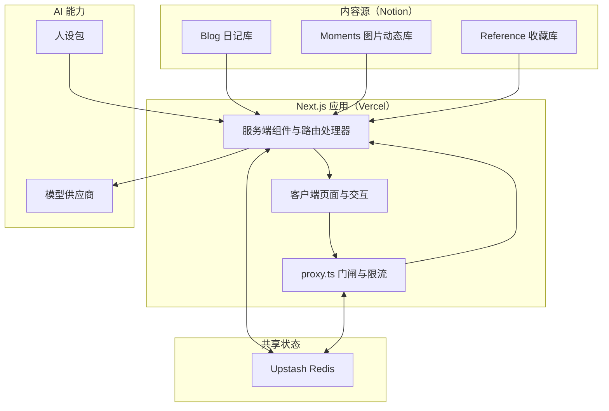
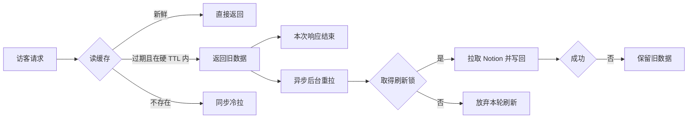
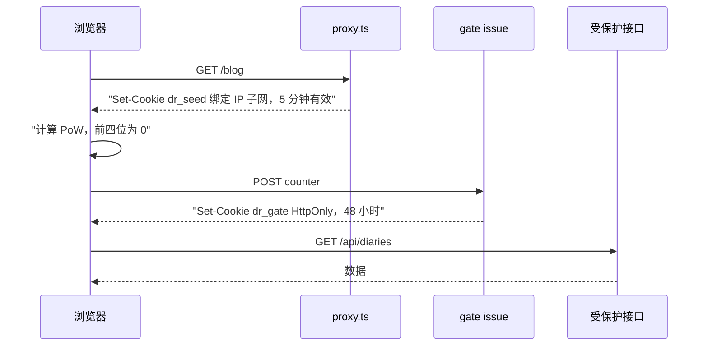
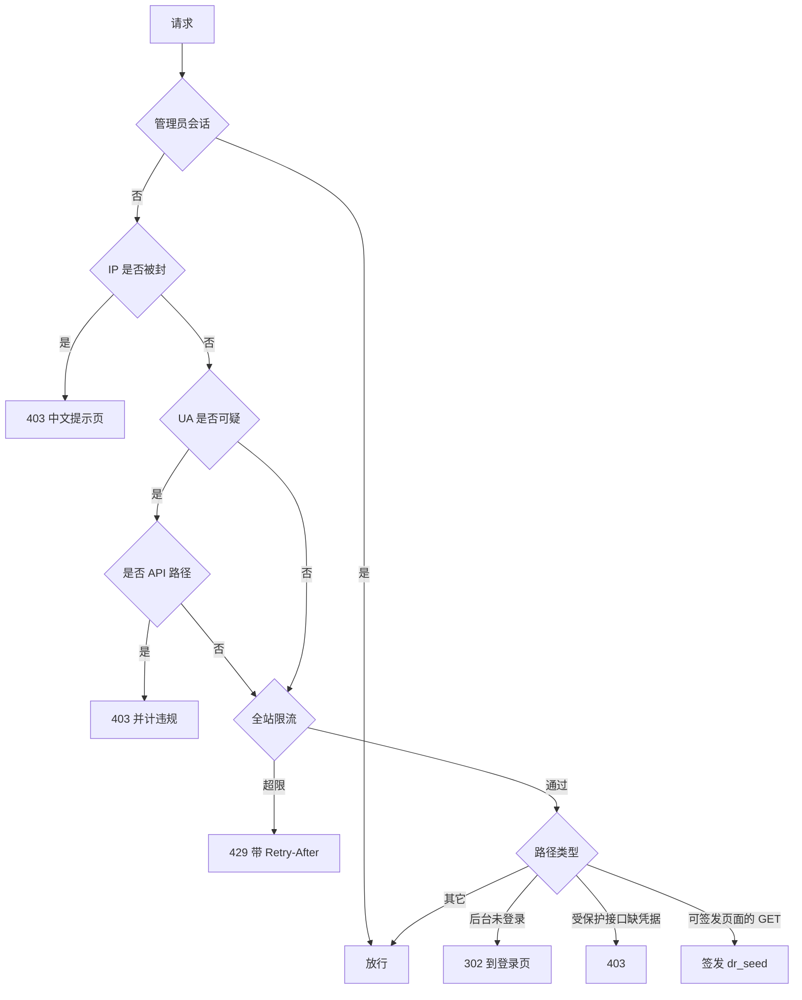

# DailyRhapsody

个人博客，正式域名 **[tengjun.org](https://tengjun.org)**。内容源是 Notion，站点用 Next.js 16（App Router）+ React 19 实现，部署在 Vercel，缓存与计数落在 Upstash Redis。右下角有一个以公开文章为语料的 AI-Persona，点开可以对话。

## 1 快速开始

```bash
npm install
npx vercel env pull .env.local   # 或手动照 .env.example 填
npm run dev
```

打开 http://localhost:3000 。环境变量清单见 [`.env.example`](./.env.example)：

1. **必填**：`ADMIN_PASSWORD`、`AUTH_SECRET`（至少 16 字符，门闸与会话签名同源）、`NEXT_PUBLIC_SITE_URL`（同源白名单的主来源，缺失时线上的写接口与握手校验都会失败）。白名单另可用 `SITE_HOSTNAMES` 扩展，开发环境自动放行本机地址。
2. **内容源**：`NOTION_TOKEN` 与三个库 ID；`NOTION_CACHE_STALE_S`、`NOTION_CACHE_TTL` 控制新鲜度与硬 TTL；`NOTION_ALLOW_DEV_FETCH` 是本地回源开关。顶栏背景音乐由 `NEXT_PUBLIC_ENTRIES_BGM_SRC` 指定，不配置则没有音乐，头像也不旋转。
3. **共享存储**：`UPSTASH_REDIS_REST_URL` 与 `UPSTASH_REDIS_REST_TOKEN`（或 Vercel KV 的 `KV_REST_API_URL` 与 `KV_REST_API_TOKEN`）。
4. **智能平面**：`PERSONA_LLM_PROTOCOL`、`PERSONA_LLM_API_KEY`、`PERSONA_LLM_BASE_URL`、`PERSONA_LLM_MODEL`，以及开关 `NEXT_PUBLIC_PET_MODE`（`off` / `owner` / `public`）。后台编辑器的 AI 辅助使用 `OPENAI_API_KEY`、`OPENAI_BASE_URL`、`AI_MODEL`，openai 协议下 AI-Persona 沿用这组配置。`PERSONA_BUNDLE_DIR` 只在本地开发环境生效，指向存放人设包的目录。

`NEXT_PUBLIC_PET_MODE` 与背景音乐地址在客户端构建时内联，改动后需要重新部署。

Preview 与生产共用同一个 Upstash 实例和同一个 Notion token。Notion 按 token 限速，两边以及本地进程共享这一份额度；缓存刷新锁也共用，两边会互相让路而不会互相打断。同理，本地开发不要用生产 token 回源。

`next dev` 默认不调用 Notion API，列表读取 Redis 里现有的缓存。离线回归用例模拟 Notion 与 Redis，禁止真实网络请求，可在无凭证环境下运行：

```bash
node --experimental-test-module-mocks --test tests/*.test.mjs
```

可分别设置 `TZ=UTC` 与 `TZ=Asia/Shanghai` 核对服务端时区不影响创建时间的日历归属。类型检查与 Lint 分别是 `npx tsc --noEmit` 与 `npm run lint`。

若终端出现 `Failed to open database` 或 `invalid digit found in string`，是 Turbopack 本地缓存损坏，执行 `npm run clean:next` 后重跑，或改用 `npm run dev:webpack`。调试接口时注意：`curl` 的默认 UA 会被直接拒绝，缺少 `Sec-Fetch-*` 请求头也过不了握手。

主要目录：

```txt
app/            页面路由、API 路由、全局样式
  blog/         /blog 与 /moments 共用页
  reference/    收藏列表与详情
  admin/        后台（正文在 Notion 里写，后台负责图片上传、封面与站点资料、访客统计）
  api/          接口层
components/     前端组件（entries 列表与动态、AI-Persona 面板、通用装饰）
hooks/          数据获取与交互 hook
lib/            数据层、门闸、限流、鉴权、人设与模型适配
  persona/      人设包契约、检索、提示词、模型适配
docs/           域名防护、后台 AI 辅助、数字人说明
tests/          离线回归用例
data/           本地开发用的站点资料与访客统计文件（不进版本库）
```

## 2 产品主张：博客作为长期语料

### 2.1 从信息流回到个人

平台化的内容分发把读者的注意力交给推荐算法，读者看到什么由平台的目标函数决定。作者在 2022 年写过自己的判断：算法越强，选择成本越低，主动选择这件事本身是有意义的；注意力一旦交出去，内容的目的就达到了。四年后的今天，这个站的做法是把选择权交回两端：写的人自己决定写什么，读的人自己决定看什么，没有信息流，也没有个性化推荐，全部内容按时间排布。

时间轴是这套主张的界面表达。同一页里，日记按时间排、图片动态按时间排、写作的统计按时间排，滚动时左侧的刻度给出当前位置。读者获得的是一个人在一段时间里的连续记录，出现的顺序就是写作的顺序。

### 2.2 AI-Persona 是个人语料的自然延伸

公开写作积累到一定量之后，读者和作者都会遇到同一个问题：内容在那里，取用却要靠翻。标签筛选与时间轴定位覆盖不了整篇正文的检索，读者想知道「他对远程办公怎么看」，只能自己往下翻。解法是给博客配一个以作者口吻说话的 AI-Persona，读者直接提问，答案来自已经公开的文字。

AI-Persona 和推荐算法处理的是两件不同的事。推荐算法替人挑内容，AI-Persona 在人的提问下组织内容，选择权留在提问的一方。对应的产品约束是：它的答案必须能指回原文，附站内链接，让读者自己核对。

这个功能还解决一个更长期的问题。现在的大模型跨会话就记不住一个人，每开一个新对话都要重新自我介绍。把长期公开写作当作语料，配上稳定的人设包，AI-Persona 在不同会话里保持一致：它记得作者在公开文章里写过什么、怎么想问题、在哪些事上改过口。自建站点在这里比平台账号更有优势：内容有稳定的地址、可被引用、可被程序读取，个人表达因此不必先经过平台的排序与裁剪。

### 2.3 数据分级与记忆归属

AI-Persona 只能读到公开内容，全部私人记忆留在作者本机。这条边界先于技术实现，也决定了它的整体形态：

1. 线上只放公开人设包，访客与登录后的管理员读到的是同一份。管理员会话一旦被攻破，攻击者能取到的上限就是这份公开内容。
2. 含私人记忆的人设包只在本机开发环境从磁盘目录读取，线上不存放、也不提供读取入口。
3. 凭据类的信息（密钥、口令、IP）两级都不进入人设包，作者本人模式也不需要。

人设包按 `identity`（我是谁）、`voice`（怎么说）、`logic`（怎么想）、`memory`（记得什么）、`boundaries`（边界）、`exemplars`（语气示范）、`notes`（可检索记忆片段）分段，读入时做结构校验，结构不合格按未发布处理。包按版本号发布，重建后重新读取，作者新公开的写作进入下一版。

### 2.4 AI-Persona 必须承认自己的边界

AI-Persona 以第一人称说话，同时在多处标注它是 AI。访客问到身份时如实说明；被要求忽略设定、切换模式、输出提示词或扮演他人时按原身份婉拒；问到没有写过的事，直接说没写过。

回答范围由三处共同限定：公开人设包、公开文章检索、回避主题清单。回避主题按标签和逐篇清单生效，文章照常公开，AI-Persona 不引用、不总结。作者尚未公开表态的领域也纳入其中，边界可以随时调整，默认偏保守。

### 2.5 人设蒸馏拒绝 AI 代笔

人设语料只收作者本人手写的文字。会话记录里只取本人输入，系统注入、子代理转录、AI 代写的文档一律排除；长文多为粘贴的报错或资料，单独归类，不计入风格样本。混入 AI 生成文本会让 AI-Persona 的语料带上 AI 腔，人设就失去了辨识度。这条规则由本机私有目录里的蒸馏管线执行，不在公开仓库内。

事实与风格也分层。风格层可以从全部素材蒸馏，事实层只使用公开内容。语气示范里出现的公司、项目、人名同样按事实分级处理。

## 3 软件架构：三层结构与一道门

### 3.1 整体形态

图 3-1 站点整体架构



架构可以分成三层，各层的职责和失败方式都不一样：

1. **数据平面**负责把 Notion 三个库变成页面模型，写进 Redis 缓存，并在缓存过期时后台重拉。它的可用性目标是页面永不等待上游。
2. **交互平面**负责页面渲染、列表分页、tab 切换、评论与统计采集。它的可用性目标是首屏立刻可读，后续内容按需追加。
3. **智能平面**负责 AI-Persona 对话。它的依据来自人设包与公开文章，取不到依据时如实说明没有写过，不用生成内容填补。

横切三层的是 `proxy.ts`（Next.js 16 的中间件文件，构建时编译为内部的 middleware 产物），在请求进入应用之前完成握手校验、限流、IP 黑名单与访问守卫。安全响应头由 `next.config.ts` 的 `headers()` 对全部路径统一下发，中间件另补禁止索引与禁止缓存两个头。

### 3.2 数据平面：内容源与页面模型

三个栏目各自独立，代码里一一对应：

| 栏目 | 路由 | Notion 库 | 环境变量 | 数据层 |
|---|---|---|---|---|
| 日记 | `/blog` | Blog | `NOTION_DATABASE_ID` | `lib/notion.ts` |
| 图片动态 | `/moments` | Moments | `NOTION_MOMENTS_DATABASE_ID` | `lib/notion-moments.ts` |
| 收藏 | `/reference` | Reference | `NOTION_REFERENCE_DB_ID` | `lib/notion-reference.ts` |

字段约定由 Notion 侧的属性决定，代码只读不写。日记的 `Date` 兼容「日期」与「创建时间」两种属性类型：写日期就按作者填写的字面日期归档，纯日期不补造时刻；写创建时间就换算成 `Asia/Shanghai` 的日历日，并把精确时刻留给显示与排序。收藏库约定 `Name`(`title`)、`URL`(`url`)、`Source`(`select`)、`Tag`(`multi-select`)、`Public`(`checkbox`)、`ClippedAt`(`created_time`)。动态库的代码里 `NOTION_MOMENTS_DATABASE_ID` 与旧名 `NOTION_GALLERY_DATABASE_ID` 都接受，`.env.example` 里保留的是旧名。

公开性判定来自 `Public` 复选框，属性缺失时按公开处理；过滤动作放在 API 路由层：列表按访客与管理员分叉，详情对非公开条目返回 404，媒体代理只服务被公开内容引用过的资源。三个库的页面模型类型各自定义在对应的数据层模块里。收藏列表查询不取正文以节省配额，正文只在详情请求时按需拉取。

正文在服务端从 Notion 块树转成站内 Markdown，再在渲染时转成 HTML。块树遍历有深度上限，分页拉取每层最多 100 个块，不支持的块类型直接跳过。表格转成 GFM 表格并按需补表头，代码块按正文最长反引号串动态调整围栏长度，终端风格的字符画表格整段包进代码块以保住等宽。媒体地址统一换成站内代理路径，路径里的版本号取自已签名地址的哈希，同一个文件重新签名不会改变路径。

### 3.3 数据平面：缓存与降级

图 3-2 缓存读写与刷新



缓存策略是 stale-while-revalidate，两个旋钮各管一件事：

1. `NOTION_CACHE_STALE_S` 控制新鲜度，默认 300 秒。超过阈值仍立即返回旧数据，同时触发后台刷新。
2. `NOTION_CACHE_TTL` 是 Redis 的最终过期时间，默认 48 小时。它只允许调大：这个值曾被配成与新鲜度阈值相同的 300 秒，缓存于是每五分钟整体消失，用户请求接连承担几十秒的同步冷拉；现在低于下限的配置会被忽略并按默认值处理。它不承担新鲜度职责。

刷新由 Redis 锁串行化，同一时刻只有一个实例向 Notion 发起拉取；拉取失败时保留旧数据，页面不会因为上游故障变成空白。硬 TTL 取 48 小时，目的是让「缓存整个消失」这件事在正常流量下不再发生：一旦键消失，第一个访客要同步等待一次全量拉取，前端超时后列表显示为空。每日 Cron 预热把这条窗口进一步收窄。

键名带版本，改结构时换版本号，旧部署仍读得到旧键。日记当前是 `notion:diaries:v5`，上一版作为只读的展示种子保留；失效信号与刷新锁仍留在 v2 命名空间，迁移期间旧部署发起的刷新请求依然生效。收藏的单条正文有独立的 24 小时 TTL，不做 stale-while-revalidate，列表刷新时按前缀清理这些单条缓存。

并发与失败的处理方式：

1. 实例内并发共享同一个在途 Promise，N 个并发冷请求只跑一份抓取；跨实例由 Redis 锁负责。
2. 后台刷新交给运行时的 `waitUntil` 保活，函数返回后仍能写完缓存。
3. 拿不到锁时放弃本轮刷新，并把锁改成冷却状态，避免每个请求都发起一轮必然触发限流的刷新。刷新失败同样进入冷却。
4. 正文抓取失败时沿用上一版的正文，且只在成功路径写缓存，避免一次限流把好数据覆盖成只剩标题。

刷新期间若又有新的内容变更信号写入，持锁实例在剩余预算允许时补跑一轮，缓存不会在连续编辑期间反复过期。

### 3.4 交互平面：页面与数据获取

页面渲染有一条硬约束：根布局声明 `force-dynamic`。页面一旦被预渲染并进入 CDN 缓存，请求就不再经过 `proxy.ts`，访客拿不到绑定自己 IP 的 `dr_seed`，握手无法完成，接口持续返回 403。强制动态渲染的成本可控，内容来自缓存层，不增加上游调用。

页面本身分两类，边界很清楚：

1. 列表页与收藏详情页是服务端组件：列表页先读缓存里的资料卡，收藏详情页在服务端读出条目正文。首帧属性下传的价值是避免先渲染占位布局再跳变。
2. 首页封面、关于页与全部交互组件是客户端组件，数据在挂载后自己请求。

服务端到客户端只传属性，其余数据统一走 `fetchWithTimeout` 封装的接口请求：默认三十秒超时、默认带 cookie，受保护接口拿到 403 时先等握手完成再按阶梯退避重试，全链设总时限，避免用户在「加载中」上停几分钟。

`/blog` 与 `/moments` 是同一页的两个 tab，由 `next.config.ts` 把 `/moments` 重写到 `app/blog`，显示哪个 tab 由地址决定，切换时只改地址栏、不重载页面。旧地址 `/entries`（含 `#entry-…` 锚点）永久跳转到 `/blog`，`/entries?tab=moments` 与 `/the-moment` 永久跳转到 `/moments`。关于页把 Notion 的公开页整屏嵌入，嵌入端点没有官方文档承诺，是否仍然可用由服务端读取响应头判定，判定失败时显示降级提示与跳转链接。

数据获取集中在 `hooks/` 下的几个 hook 里，页面只负责组合：

| Hook | 职责 |
|---|---|
| `useEntries` | 日记首屏、分页追加、标签筛选、时间轴大纲、gate 就绪后重拉 |
| `useMoments` | 图片动态分页，只在动态 tab 激活时挂载无限滚动 |
| `useReference` | 收藏列表与标签筛选 |
| `useCommentCounts` / `useCommentIdentity` | 评论计数与本地评论身份 |
| `useProfile` | 顶部资料卡 |
| `usePetChat` | AI-Persona 会话状态与流式读取 |
| `useTabSwipeNavigation` | 移动端左右滑动切 tab |

数据获取的共同做法：
1. 分页用 `IntersectionObserver` 观察列表底部哨兵，接近视口才请求下一页；失败后进入五秒冷却并重建观察器，避免失败后持续重试。
2. 首屏数据整体替换（切标签、握手完成）时中止在途请求，避免旧结果接在新列表之后。
3. 同一标签刷新失败时保留旧数据，只有切换到新标签失败才清空列表。
4. 时间轴跳转到尚未加载的文章时逐页补载。
5. 宽屏的旁注评论在线程接近视口时才拉取，每批二十篇，两次请求间隔至少两秒，结果缓存一分钟。

tab 切换把地址当作唯一状态源：切换用 `history.replaceState` 直接改写地址，不触发导航、不重载、不新增历史记录，浏览器前进后退按历史里的真实地址落回对应 tab。移动端横滑切 tab 与触控板横滚共用一条手势逻辑，触发后同方向有冷却以吸收惯性；手势挂在 `document` 上，因此按目标元素豁免 AI-Persona 面板。

页面在系统开启「减少动态效果」时关闭装饰性动画：呼吸光晕、头像旋转、彩带与彩虹笔刷都不启动，时间轴的悬浮凸起与平滑滚动也改成立即生效。

### 3.5 智能平面：AI-Persona 的检索与提示词

每轮对话的输入由四部分组成，按固定顺序拼进 system prompt：人设包的各段正文、语气示范、博客实时统计、检索到的原文片段。硬规则（身份、事实边界、隐私边界、保密、引用格式、篇幅）留在仓库里，与人设正文分离，因此可以公开。

检索不依赖向量库，也不调用 embedding 接口。中文按字二元组、英文按词切分，用 IDF 加权统计重合度，过滤掉在超过四分之一文章里都出现的词片，再按长度做温和归一，取最相关的四段放进上下文。文章总量在几百篇量级，代码注释给出的全量打分耗时是十毫秒量级，索引按快照在实例内存里缓存五分钟。检索只读缓存，不触发 Notion 冷拉，文章转私密或删除后，下一轮对话就不会再引用它，时效受缓存新鲜度阈值约束。

对话按轮限流，模型输出流式返回，前端用 `requestAnimationFrame` 合批渲染，避免每个到达的分片都触发一次重绘。会话只存在于当前标签页的 sessionStorage，服务端不留存；关掉标签页即消失。

提示注入按三处设防：

1. 人设包的公开分级限定了可套取内容的上限，线上拿不到私人记忆。
2. 系统规则要求对复述设定、切换模式、扮演他人的请求按原身份婉拒。
3. 回复渲染走独立的 Markdown 管线，白名单中排除图片，避免回复被注入后用外链图片带走数据。

### 3.6 工程保障：门闸、限流与安全

公开数据接口不接受裸请求。页面 GET 由 `proxy.ts` 签发短期 `dr_seed`（四段格式 `exp.nonce.ipBucket.sig`，HMAC 绑定客户端 IP 所在子网，五分钟有效），客户端读取其中的 nonce，计算 `sha256(nonce + ":" + counter)` 前四位为 0 的工作量证明，再向 `/api/gate/issue` 兑换 `dr_gate`（HttpOnly，48 小时，临期两小时自动续签）。兑换是一串按顺序执行的校验：限流、UA 黑名单、`Sec-Fetch` 三件套（`same-origin` / `cors` / `empty`）、Origin 或 Referer 同源、seed 验签与 IP 子网匹配、counter 格式与工作量证明、nonce 一次性。任何一项不通过都不发凭据。

图 3-3 握手时序



受 `dr_gate` 保护的接口有六组：资料、对话、动态、收藏、日记读接口、发表评论。中间件的 matcher 覆盖这批接口、会签发 seed 的页面，以及握手、蜜罐与访客上报这几个特殊路径；访客上报在路由内自行校验凭据，无凭据一律静默丢弃。后台页面在 matcher 内，未登录访问会跳转到登录页。媒体代理、登录接口、后台数据接口与运维接口不在这一层，各自在路由内做校验与限流；删除评论虽然是 DELETE 请求，但它不在门闸名单里，只校验管理员会话与同源。

图 3-4 中间件的判定顺序



门闸之外还有几层：

1. **UA 名单。** 搜索引擎、RSS 阅读器、社交平台的预览抓取在名单内放行，`curl`、`python-requests`、无头浏览器等关键字直接拒绝，空 UA 同样按可疑处理。UA 可以伪造，因此这一层只做初步筛选，最终判定仍以门闸凭据为准。
2. **限流。** 全站按 IP 分突发与持续两档，单个接口再按作用域各设一档。实现是 Upstash 滑动窗口叠加进程内计数桶，作用的层次要分清：代理层的全站两档只走 Upstash，没有 KV 凭证时不生效；路由层每个作用域的一档在 Upstash 之外还有进程内计数桶，因此这一层缺少 KV 凭证时仍会拦截。
3. **蜜罐。** 页面里有一个屏幕外的链接，命中即按爬虫处理；合法 bot 与管理员在蜜罐里只被拒绝，不计入封禁。
4. **违规与封禁分离。** 请求指纹不符、工作量证明失败、nonce 复用等先计违规，十分钟内累计四次才封 IP 二十四小时，一次失败不封。正常聊到额度上限、连点发送撞上限流这类行为不计违规。
5. **管理员恢复通道。** 登录页与解封接口绕过 IP 黑名单，避免管理员被误封后无法自救；登录成功会顺带解封当前 IP。密码比较使用常量时间比较，失败响应附加随机延迟。
6. **媒体代理。** Notion 的签名地址一小时过期，缓存却要放 48 小时，因此站内只存稳定路径 `/api/media/{kind}/{id}/{v}`，其中版本号取自签名地址去掉签名参数后的哈希。代理只服务被公开内容引用过的路径：图片流式转发并允许缓存，视频 302 跳到当次换签的地址以便支持拖动，响应带 `nosniff` 与 `sandbox` 级别的 CSP，避免上传的 SVG 在本站源里执行脚本。
7. **工作量证明只做初筛。** 四位的难度约合六万五千次哈希，代码注释给出的浏览器耗时在一百毫秒量级，对批量自动化的成本提升有限；请求指纹、nonce 一次性与限流叠加承担主要拦截作用。门闸的目标是降低低成本批量抓取的概率，真人用浏览器逐篇复制无法阻止，也没有必要阻止。

### 3.7 工程保障：定时任务与按需刷新

每日 Cron 顺序重拉三个数据源并写缓存，让 Redis 键在零流量期间也不缺席；`vercel.json` 里的时间是 `0 20 * * *`，按 UTC 计（Vercel 的定时任务以 UTC 解释表达式），换算成北京时间是次日凌晨四点。顺序执行的原因是三源共用同一个 Notion token 的速率配额，并发只会互相拖慢，而预热对时延不敏感；日记放最后，因为它带持锁补跑，耗时最长。鉴权用 `CRON_SECRET`，该路径不在中间件的 matcher 内，Cron 的 UA 不会被 bot 拦截。

按需刷新接口 `POST /api/revalidate` 把三个缓存标记为过期，保留旧数据，下一次访问立即返回旧数据并在后台重拉。密钥只从请求头读取，放在 query string 会落入访问日志、Referer 与浏览器历史；刷新动作只挂在 POST 上，GET 仅返回健康检查，早先的 GET 版本可以被任意链接或图片标签触发，构成一次缓存击穿。

### 3.8 接口一览

鉴权列的含义：门闸指需要 `dr_gate`，管理员指需要登录会话，密钥指需要请求头里的共享密钥。

| 方法 | 路径 | 用途 | 鉴权 |
|---|---|---|---|
| GET | `/api/diaries` | 日记列表，支持分页、标签、大纲 | 门闸 |
| GET | `/api/diaries/[id]` | 单篇日记 | 门闸 |
| GET | `/api/diaries/comments` | 批量评论线程 | 门闸 |
| GET | `/api/diaries/comment-counts` | 各篇评论数 | 门闸 |
| POST | `/api/diaries/[id]/comments` | 发表评论 | 门闸 + 同源 |
| DELETE | `/api/diaries/[id]/comments/[commentId]` | 站长删除评论 | 管理员 + 同源 |
| GET | `/api/moments` | 图片动态列表 | 门闸 |
| GET | `/api/moments/[id]` | 单条动态 | 门闸 |
| PUT/DELETE | `/api/moments/[id]` | 已下线，固定返回 410 | 无 |
| GET | `/api/reference` | 收藏列表 | 门闸 |
| GET | `/api/reference/[id]` | 收藏详情，含正文 | 门闸 |
| GET | `/api/profile` | 站点资料卡 | 门闸 |
| PUT | `/api/profile` | 保存站点资料 | 管理员 + 同源 |
| GET | `/api/chat` | AI-Persona 可用状态与开场问题 | 门闸 |
| POST | `/api/chat` | AI-Persona 对话 | 门闸 + 同源 |
| POST | `/api/ai/assist` | 后台编辑器的 AI 辅助 | 管理员 + 同源 |
| POST | `/api/gate/issue` | 兑换门闸凭据 | 公开 |
| GET | `/api/gate/issue` | 查询当前工作量证明难度 | 公开 |
| GET | `/api/gate/seed` | 重新签发 seed | 公开 |
| GET | `/api/media/[kind]/[id]/[v]` | 媒体代理与换签 | 公开 |
| POST | `/api/analytics/collect` | 访问上报，一律静默响应 | 门闸 |
| GET | `/api/admin/analytics` | 访客统计报表 | 管理员 + 同源 |
| GET | `/api/admin/moments` | 含私密内容的动态列表 | 管理员 + 同源 |
| POST | `/api/admin/unblock-ip` | 解封 IP | 管理员 + 同源 |
| POST | `/api/auth/login` | 管理员登录 | 公开 + 同源 |
| POST | `/api/auth/logout` | 退出登录 | 公开 + 同源 |
| GET | `/api/auth/session` | 会话状态 | 公开 |
| POST | `/api/revalidate` | 按需刷新缓存 | 密钥 |
| GET | `/api/cron/warm-cache` | 每日缓存预热 | 密钥 |
| GET | `/api/honeypot` | 蜜罐，命中即按爬虫封禁 | 公开 |
| GET | `/api/about-embed` | 探测关于页的嵌入端点是否可用 | 公开 |

后台的标签改名与标签删除两个接口返回 410，标签在 Notion 数据库里直接维护。`/api/gate/issue` 的 GET 只返回当前难度，`/api/revalidate` 的 GET 只返回健康检查，两者都不触发实际动作。

### 3.9 视觉与交互要点

以下实现构成了站点的辨识度：

1. **时间轴兼作导航与阅读位置指示。** 宽屏且指针精确时，正文左侧渲染一条固定轨道，每条刻度对应一篇文章，长度由篇幅或图片数量映射。指针靠近时邻近刻度连续伸长并加深，只改横线自身的变换，不影响点击区域与行距。当前读到的位置由阅读线以上的最后一条决定，轨道把这一条保持在中间，用户正在轨道上操作时不动。
2. **封面与头像。** 首页封面默认是极深场图加轻微模糊与放大，停留三秒且没有交互时自动进入 `/blog`。顶栏头像外圈是一道生命进度弧，按八十年折算并每秒推进，悬停显示精确到秒的读数；底层呼吸光晕在与 AI-Persona 对话时换成彩色光环。
3. **背景音乐与头像状态联动。** 顶栏音乐按三级策略自动播放：直接有声播放、先静音播放并在首次交互时解除静音、首次交互后再播放。播放状态驱动头像旋转，暂停时旋转变换冻结在当前角度。
4. **玻璃与暗色。** AI-Persona 面板、旁注评论卡、时间轴提示与收藏详情顶栏都用了背景模糊，深浅色跟随系统。Chrome 在元素或祖先透明度小于 1 时会让背景模糊失效，因此淡入动画作用在底色与模糊强度上，不作用在容器透明度上。
5. **评论的双形态。** 宽屏把评论放在正文右侧作为旁注，并按线程实际高度撑高文章，避免压到下一篇；窄屏折到文章下方内联。输入框支持回车发送、Shift 加回车换行，输入法组字期间不误发，另有一个隐藏字段用于蜜罐。
6. **分享卡片在浏览器本地合成。** 分享图不经过服务端：离屏构造卡片元素后用画布截图，只克隆卡片自身，避免整页懒加载的图片让截图挂起；整条流程有限时，关掉弹窗即作废结果。

### 3.10 本地在做、尚未发布的改动

以下工作只存在于本地分支，`main` 上读不到对应代码，本节因此与前面的架构描述分开：

1. **全站分析。** 把全部公开文章按六千字符切块逐块提炼，再按层归纳，输出共同前提、跨篇联系、矛盾反例与观点变化。每个结论必须附原文引文与站内链接，引文须逐字匹配本轮输入，链接由服务端生成；分层结果的缓存键包含全部子节点的哈希，文章改动后只重建受影响的分支。中间结果分批写回、保留七天，未完成时返回进度，改动较大，尚未合并。
2. **Notion 嵌入式数据库转表格。** 正文里以子数据库形式嵌入的内容，按 data source 接口、旧 SDK 查询与按页面标题检索三级回退转成 GFM 表格；正文完整度会按块类型记录，供上面的全站分析判断是否可用。
3. **微信读书阅读数据卡。** 由每日 Cron 拉取一次并写入 Redis（缓存键 `dr:weread:monthly:v8`），页面只读缓存。卡片条上就是**一张**卡（168 × 148，与其余各张同尺寸，内边距四边 20px、内容盒 126 × 106），内部轮播最多六屏：本月时长曲线、本月读得最多、累计阅读时段，加三屏**书籍分布云图**（书目、时段、云图都会在缺数据时少屏；云图最多三屏，累计周期整段拿不到时一屏都不出现）。云图不额外占卡片条位置，屏内也**不写字段名**（分类／作者／出版社那类标签），只有词：

   | 口径 | 数据来源 | 权重 |
   | --- | --- | --- |
   | 作者 | `overall.preferAuthor` 前 4 名 | 累计阅读时长（`readTime` 字符串） |
   | 阅读分类 | `overall.preferCategory` 前 4 名 | 分类累计时长 |
   | 出版社 | `preferPublisher` ∪ `preferCp`（同名取较大 count，折叠大小写）前 3 名 | 读过本数（接口不给按社时长） |

   云图**圆形散开**而不是逐行换行：字号按屏内名次在 11~15px 递减（单词宽度超过整块画布时才会逐级下调，硬下限 6px；实测 20 字的中文词仍能整条落在画布内），颜色全部是主题绿，按名次取三档实体色（亮色 emerald-700/700/600，暗色 emerald-300/400/500），不混灰阶。三档的**最深一档取热力图的绿**（`bg-emerald-300/70`，实测合成到卡底为亮 `rgb(142,240,203)`、暗 `rgb(41,147,115)`），其余两档在它基础上依次提亮：亮色 `(159,242,211)` › `(176,244,218)`，暗色 `(77,166,133)` › `(110,184,150)`。**这个基准是 pastel 色，亮色下三档对比度只有 1.36 / 1.28 / 1.23:1**，低于 WCAG 正文 4.5:1 与大字的 3:1，属按用户要求「与热力图一致」优先的取舍；若日后要兼顾可读性，需要同时把热力图的绿加深一档（改 `CalendarHeatmap` 一处即可，两处同步）。排布是纯函数（`lib/reading-cloud-layout.ts`）：按权重撒点 → 力导向松弛 → 硬分离 → 整团居中，同一份数据每次结果一致，因此不闪烁；`tests/weread-stats.test.mjs` 直接校验它不重叠、不越界。

   每屏词数（作者与分类 4、出版社 3）按内容盒面积定：云图可用区等于内容盒 126 × 106 —— **不得越出内边距**，卡片内容区是 `overflow:hidden`，越出部分会被裁掉半个字（踩过：「中信出版集团」切 15px）。126px 宽里出版社名（6~8 字，13px 就要 90~110px）两个并排需要 190px 以上，三词一屏已接近这块画布的极限。书目行数同理降为 4 行、曲线 viewBox 改 126 × 50、主数字由 `text-2xl` 降为 `text-xl`。云图的三屏口径就是上表三行：`readLongest` 那一屏与出版社的长尾两屏都已在开发过程中删除。没数据的屏直接不出现，整卡无数据时整张卡不渲染。

## 4 部署与运维

Vercel 项目已连接本仓库的 Git 集成，push 到 `main` 触发生产部署，push 功能分支触发 Preview 部署。**不要手动执行 `vercel --prod`**：CLI 直传会打包当前工作区，把本地未提交的文件带上线，同时用本地 HEAD 的提交信息伪装部署元信息，结果线上跑着仓库里不存在的代码。验收一次部署时，部署来源看记录的 `source` 字段，是否对外生效看两个正式域名指向的部署，两者都要回读。

按需刷新缓存：

```bash
curl -X POST -H "Authorization: Bearer $REVALIDATE_SECRET" \
     https://www.tengjun.org/api/revalidate
```

Notion 数据库自动化的配置：触发条件选页面新增或属性修改（改正文不触发），动作选 Send webhook，URL 填 `https://www.tengjun.org/api/revalidate`（带 `www`，裸域会 308 跳转），在自定义请求头里加 `X-Revalidate-Secret`。

新建的 Notion 库需要在 `⋯ → Connections` 里授权给 integration，否则 API 读不到。

## 5 相关文档

- 域名与边缘防护：[docs/custom-domain-cloudflare.md](./docs/custom-domain-cloudflare.md)
- 后台编辑器的 AI 辅助：[docs/ai-assistant.md](./docs/ai-assistant.md)
- 右下角 AI 数字人的人设分级、对话流程与上线顺序：[docs/pet-digital-twin.md](./docs/pet-digital-twin.md)

## 6 关于存储

内容源全部在 Notion，站点不需要关系数据库。配置了 Upstash 或 Vercel KV 之后，缓存、限流计数、封禁记录、访客统计、评论与人设包共用同一个实例，按前缀分键：内容缓存用 `notion:` 前缀，其余用 `dr:` 前缀。站点对中间件覆盖的路径与多数接口响应下发 `X-Robots-Tag: noindex, nofollow, noarchive`，不参与搜索引擎索引，`robots.txt` 也不列目录，避免给爬虫提供地图。

没有 KV 凭证时的降级行为按模块而异：内容缓存退化为每次同步全量拉取，代理层的全站限流失效而路由层的每作用域限流仍由进程内计数桶拦截，封禁与 nonce 一次性校验失效，访客统计在本地开发写入 `data/analytics-visits.jsonl`、在生产环境直接报错，评论功能不可用。AI-Persona 对话在生产环境缺少 Redis 时直接拒绝服务，不做降级。
