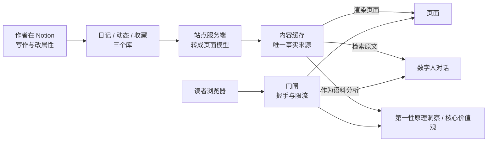
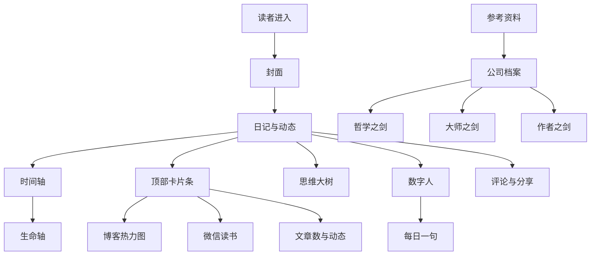

# DailyRhapsody

个人主页，正式域名 **[tengjun.org](https://tengjun.org)**。作者在 Notion 里持续写作，站点把日记、图片动态与站外收藏公开出来：读者沿时间往前翻，也可以点开右下角的数字人直接提问。

## 1 站点定位

### 1.1 解决的问题

公开写作积累到一定量之后，问题出现在取用上。内容都在那里，要找某一篇只能逐篇翻，想找某个话题下写过什么也只能一路翻过去。站点的做法是把每一篇放进一条按时间排布的轨道，再给出三个入口让旧内容重新可用：沿时间往前翻，按标签筛，或者向数字人提问。

按时间排布对应作者的一个判断：他在 2022 年 6 月的日记里引用苏杰《淘宝十年产品事》，算法越强大，买家的选择成本越低，而买家做选择这件事本身有意义。

### 1.2 目标读者

站点主要面向第一次接触的读者：不了解作者，也不一定有耐心从最新一篇往回翻几百篇。作者本人写了一段时间之后，回头找旧内容时面对的是同一批文章。

### 1.3 核心主张

1. 排序依据只有写作时间。站点不设信息流，不做个性化推荐，读者看到的就是作者写下的顺序。
2. 表达留在自建站点。文章有稳定地址、可被引用、可被程序读取，不必先经过平台的排序与裁剪。
3. AI 的答案必须可回溯。数字人的回复引用公开原文并附站内链接；两个文章分析技能（第一性原理洞察、核心价值观）的每条结论都带逐字引文。
4. 公开与私密分开存放。线上只有公开内容与公开人设，私密记忆留在作者本机。
5. 防护的能力上限写在明处。公开接口前的门闸抬高批量抓取的成本，读者用浏览器逐篇复制不受影响，也没有必要阻止。

### 1.4 能力与边界

**读者能做什么**

1. **沿时间翻**：日记与图片动态共用一条时间轴，宽屏正文左侧的刻度对应每一篇，点一下跳到那一篇；尚未加载的文章会逐页补上。
2. **按标签筛**：日记与收藏都支持按标签筛选，日记页的标签按出现次数映射字号，常用的更醒目，再点一次取消。
3. **向数字人提问**：右下角有一个数字人，依据是已经公开的文章作答。
4. **点击「第一性原理洞察」**：服务端把全部公开文章读一遍，给出跨篇的结论，每条附逐字引文。
5. **评论与分享**：留下称呼与头像即可评论；任何一篇都能在浏览器本地合成一张分享图。

**边界**

1. 站点只读 Notion 里的公开内容：非公开条目访问不到，未被公开内容引用过的图片与视频也不转发，数字人与两个文章分析技能都不读它们。
2. 数字人只依据公开内容作答，作者没有公开写过的事直接说明没写过；回避主题清单内的文章照常公开，数字人不引用、不总结。
3. 两个文章分析技能只把文章文字当资料，文章里出现的指令一律不执行。
4. 站点面向读者的浏览与提问，不承诺开放注册、多人协作或内容分发。

## 2 内容来源与发布

### 2.1 内容流向

图 1 内容路径与门闸位置



### 2.2 三类内容

1. **日记**（`/blog`）：站点的主体，按写作日期归档。
2. **动态**（`/moments`）：图片与视频的短记录，与日记共用一页，按时间排布。
3. **参考资料**（`/reference`）：机器人领域的行业与竞品资料库，保留类型、领域、年份、摘要、许可、版权与附件；Notion 是录入后台，站点用画廊呈现。

### 2.3 发布方式

三个库各自设有公开性字段，站点只读不写。正文在服务端转成站内格式再渲染，表格、代码块与终端风格的字符画都能正常显示；图片与视频换成站内地址，内容源里的签名地址过期不会让已发布的页面掉图。

作者在 Notion 里写作与改属性。改属性会触发站点刷新，下一次访问即可见；改正文不触发刷新，等缓存过期后自动更新。

## 3 数字人（AI-Persona）

右下角的入口点开是与访客对话的数字人，它以作者的第一人称说话，依据是公开人设包与全部公开文章。人设包在线上固定存放，不同时间来的读者拿到的是同一套内容。

### 3.1 回答方式

1. **回答有据**：答案只在公开文章与人设记忆片段里找；回答前数字人会自己翻资料（检索、读原文、查统计，全部只读，最多 4 次）——取最相关的几段作答，回复附站内链接。
2. **承认边界**：被问到身份时如实说明自己是 AI；被要求忽略设定、切换模式或扮演他人时按原身份婉拒；问到作者没有写过的事，直接说没写过。
3. **提示注入设防**：线上只有公开人设包，套取最多拿到这份公开内容；回复不渲染任何图片，外链不可点，被注入的内容无法借外链图片带走信息；数字人翻到的内容只当资料，其中的指令不执行。

### 3.2 人设分级

人设分级先于技术实现，也决定了数字人的整体形态：访客可以用提示注入把上下文整段套出来，管理员会话也可能被攻破，所以线上能取到的上限就是这份公开内容。

1. 线上只放公开人设包，访客与登录后的管理员读到的是同一份。
2. 含私密记忆的人设包只在本机开发环境从磁盘目录读取，线上不存放，也不提供读取入口。
3. 密钥、口令、IP 一类的凭据任何一级都不进入人设包。
4. 包按身份、语气、思考方式、记忆与边界分段，读入时做结构校验，不合格按未发布处理。

### 3.3 语料与额度

1. **语料只收本人手写**：AI 代写的文档与系统注入的内容排除在风格样本之外，避免人设带上生成文本的腔调。这条规则由本机私有目录里的蒸馏管线执行，不在公开仓库内。
2. **额度分档**：访客按 IP 每日 30 轮，全站每日 600 轮，到上限只是暂停，不影响之后的正常访问；两个文章分析技能另算额度，共用同一个池子（滚动 24 小时 120 次真实模型调用）。
3. **会话留存**：对话只存在当前标签页，站内跳转能接上，关闭标签页即消失，服务端不留存。

## 4 Skill 与文章分析

### 4.1 Skill 的形态

Skill 是站点对一个访客动作的固定响应：访客点一下按钮，服务端按预设提示词与流程跑完，返回一份结果。它复用数字人对话的通道与限流，访客只能决定点或不点，输入不参与，提示词控制权留在服务端。

Claude Code 的 Skills 指给编码助手动态加载的指令包，与这里的 Skill 是两回事。

Skill 的目录与实现登记表分两个文件存放，新增一个 Skill 要在两处各加一条，面板按钮与进度文案自动出现。目录里目前有「第一性原理洞察」与「核心价值观」两条，字段清单与分开存放的理由见数字人文档。

### 4.2 第一性原理洞察

点击「第一性原理洞察」后，服务端读取全部公开文章，给出共同前提、跨篇联系、反例与观点变化。每条结论附逐字原文引文与站内链接，引文对不上原文的那一条直接丢弃，其余已验证的内容照常保留。

文章新增、修改或撤回公开后，下一次请求只重算受影响的依据。分析未完成时返回进度，中断或重试都保留已验证的部分；这项功能的额度与访客的普通聊天轮次分开计算。

### 4.3 核心价值观

点击「核心价值观」后，服务端读同一批公开文章，输出作者看重的价值、取舍代价与价值排序。排序只依据文中的取舍表述（为了什么让渡了什么）与独立文章篇数，证据不足就写明证据不足。

转述他人的话、一时的情绪、以及没有代价支撑的事实判断都不算价值证据；被处境逼迫的放弃记为约束，主动让渡的部分才属于取舍。每条结论同样附逐字原文引文与站内链接，与「第一性原理洞察」共用同一份分析额度，缓存与进度互不干扰。

## 5 产品功能

### 5.1 功能地图

站点把公开写作拆成四条使用路径：沿时间读、按主题找、向数字人问、按资料查。四条路径共用同一份公开内容缓存，页面不等待上游，读者也不会被推荐流带走。

图 2 产品功能地图



功能取舍遵循以下规则。文字承担主要内容，图像与动态只做辅助；页面以静态内容为主，减少视频、弹窗和自动播放对阅读的干扰；每个入口对应一个明确动作，读者不需要先学习一套操作。

这些功能背后有一条一致的产品判断：博客是公开身份与长期记忆的载体，读者需要停留和回看，站点不追求即时消费。排序按写作时间，取用靠时间轴、树、标签与提问；页面保持静态，图像和音乐只做气氛，不争夺文字注意力；入口必须让读者一眼知道点下去会发生什么。

每日一句、思维大树、微信读书卡与公司档案三剑是近期新增；时间轴、生命轴、背景音乐与热力图是更早的设计。功能的新旧不决定去留，能否承担明确动作才决定去留。

### 5.2 每日一句

数字人上方每天出现一句话，位置在入口上方，宽度限制在右侧空档。句子按北京时间每天更换一次，同一句话当天对所有访客相同；生成失败、输出不合格或模型未配置时整条不显示，不占位，也不提示。读者点叉号后，该设备当天不再出现。

写法上，服务端读取公开人设包的画像与公开记忆片段，再取一条出处明确的短句，只借它的意思重写。输出不引用原句，不署名，不出现作者姓名，长度控制在 25 到 45 个汉字。整句上限 60 个汉字，超过就当作不合格。

这项功能解决的是数字人入口的冷启动。多数读者不会主动提问，每日一句先提供一次低成本的照面，让读者感到这是一个具体的人，再决定是否继续读或提问。它不承担打卡、留存或内容分发，生成失败时宁可不显示。

### 5.3 思维大树

时间轴解决按时间读，树解决按主题找。博客文章积累到几百篇之后，列表只能表达先后顺序，主题之间的亲缘关系看不出来。树把公开文章按语义分成家族、中类与细类，用三维生长结构展示，叶子仍然指向真实文章。

树的数据生产在离线环境完成。管线读取公开日记的摘要，让模型提出分类体系并逐条归类，不读正文，不使用标签字段，也不把私密文章送进模型。分类结果写入静态 JSON，由 CDN 提供；页面请求不调用模型，树打不开时博客照常可用。当前覆盖 269 篇公开日记，归入 10 个家族、28 个中类。

入口在宽屏时间轴底部，点击后打开全屏覆盖层；叶子点击回到原文，关闭覆盖层回到原滚动位置。当前只在宽屏与精确指针环境显示入口，移动端后续补。树是索引，不生成新内容，也不替代阅读。

这项功能来自作者对呈现方式的判断：在经典瀑布流加文字之外，除非建立文章之间的内在关系，用多维度或沉浸式结构呈现，否则没有必要再换一种列表。树是这条判断的一次实现，先解决旧文取用，再谈形态。

### 5.4 时间轴与生命轴

时间轴是阅读的主轨道。宽屏正文左侧每条内容一行，横线长度由文章字数或动态的图片数量映射，当前阅读的那条高亮；悬停显示日期、字数与开头，点击跳到对应文章。跨年处标出年份，置顶文章单独成组，尚未加载的条目会逐页补载后再跳。

横线宽度只表达体量，不表达优劣。博客按字数从 10 个字到 3000 字做对数映射，动态按图片数量从 1 张到 9 张线性映射。时间轴只在宽屏与精确指针环境渲染，键盘方向键可以逐条移动，打开文章不改变地址。

生命轴在头像外圈。以出生时间为起点，按 80 年寿命比例画出一圈进度，悬停显示已经度过的日、时、分、秒，每秒更新。这个比例只用于可视化，不代表寿命判断。播放背景音乐时头像缓慢旋转，暂停时停在当前角度。

两条轴分别把写作时间和作者时间放在页面上。时间轴让读者知道自己读到哪一篇，生命轴让读者看到作者本人正在流逝的时间。头像在网络中承担脸的位置，生命轴把时间放在这张脸上，头像因此带有状态，装饰之外多了一层时间信息。

### 5.5 背景音乐

日记与动态内容流保留一条背景音乐。进入页面后站点先尝试有声播放；浏览器拦截时改为静音播放，等读者第一次点击、触摸、按键或滚动后再解除静音；两种策略都失败时，等首次交互再播放。播放中头像旋转，点击头像暂停或继续，音频循环。

音乐只在日记与动态内容流启用。进入参考资料库时音频组件卸载，避免资料页突然出声。自动播放受浏览器策略约束，刷新后可能先静音，读者第一次操作后才听到声音。

作者把这条音乐视为一段阶段性记忆，产品意义有限，后续可能取消。保留它是因为它属于这个阶段；音乐不承担导航、提示或内容功能，取消后不影响阅读。

### 5.6 微信读书

顶部卡片条第二张是微信读书阅读数据卡，由每日定时任务更新。卡片在几屏之间自动轮播，悬停、聚焦、页面不可见或系统要求减少动态时暂停，左右方向键可以手动切屏。单击卡片或按回车打开全屏详情层，层内按左右键在本月与累计之间切换。

卡片最多展示七屏：累计总览、本月阅读时长曲线、本月读得最多、累计阅读时段，以及作者、阅读分类、出版社三屏书籍分布云图。某一屏没有数据就不出现；整张卡没有数据或接入配置缺失时，卡片位留空，其余卡片不受影响。

设计上只保留作者自己的阅读痕迹。好友排行、书目技术字段与社交比较不进入卡片；本月摘要只留阅读与笔记。作者在早年的文章里写过，阅读是相对私密的行为，把读书时长放到前台会附加表演意义，阅读卡因此只做记录，不做排行榜。

### 5.7 博客热力图

顶部卡片条第一张是本月写作热力图。七列对应周一到周日，方格按当月日期排布，发布过文章的日期显示为绿色，其余日期留灰；悬停显示日期与是否发布。卡片只覆盖当前月，不提供年度视图，也不按文章数量分档。

这张卡回答的问题是“这个月哪些天写过”，不承担连续打卡、写作排名或年度总结。博客是长期写作，按月展示已经足够；缺稿的日期如实留白，读者看到的是写作节奏，站点也不设置提醒或补签。

### 5.8 参考资料与三剑

参考资料列表用画廊呈现，按类型筛选，支持点赞、下载、分享与评论；卡片点击后在新标签页打开详情。详情页从标题开始，不再放返回资料、原文、来源、许可与版权栏；公司类资料分成简介、哲学之剑、大师之剑、作者之剑四段。

哲学之剑留给一条融合后的主轴，当前尚未定稿，页面保留空位，不预置分析。大师之剑有十五个技能，每张卡标明名人、方法论与技能名；点击后服务端按当前公司生成一张判断卡，页面不提前存放分析结果。作者之剑读取公开人设，按判断、依据、点评、反证、底稿五节生成；判断分公司、目的、位置三行，三问独立，只使用公开材料与公开人设，并标明这是 AI 推断。

三把剑各做一件事。哲学之剑给唯一主轴，大师之剑给十五种可复用的提问方式，作者之剑给作者本人的价值判断。大师之剑与第 4 章的文章分析技能是两套目录：前者分析公司档案，后者分析公开文章，都经服务端调用模型，提示词与缓存分开。

参考资料解决查找，三剑解决判断。一个理论只负责一个问题，卡片必须写明理论出处、适用材料、操作步骤、反证条件与失效边界；找不到足够证据时，判断卡以“证据不足”降级，不补写结论。

### 5.9 入口、对话与互动

封面是一张极深空场图，停留三秒且没有操作时自动进入日记列表。日记列表顶部是资料卡与卡片条，下方是文章流；卡片条可横向滚动，依次是本月热力图、微信读书、文章数与动态缩略图。日记与参考资料都支持按标签筛选，日记页标签按出现次数映射字号，再点一次取消。

右下角数字人依据公开文章与人设包作答，回答附站内链接；被问到没有写过的事，直接说明没有写过；提示注入最多拿到公开人设包。两个文章分析技能的机制见第 4 章。关于页是站点的自我介绍。

评论只要称呼与头像，单篇上限 500 条；宽屏作为正文右侧旁注，窄屏折到文章下方，评论与 Notion 页面评论双向同步。任何一篇都能在浏览器本地合成分享图，分享图不上传服务器。作者登录后台后可以上传图片、设置封面与站点资料、查看访客统计。

## 6 运行与运维

### 6.1 本地运行

站点用 Next.js 16 与 React 19 实现，部署在 Vercel。

```bash
npm install
npx vercel env pull .env.local   # 或照 .env.example 逐项填写
npm run dev
```

打开 http://localhost:3000。环境变量分五组：站点地址与音乐、管理员口令与会话、Notion 内容源、共享存储（Upstash Redis 或 Vercel KV）、模型接口；`.env.example` 逐条标注了用途与默认值。

本地开发默认不调用 Notion API，列表读取 Redis 里的现有缓存，因此不要用生产 token 回源。离线回归用例模拟 Notion 与 Redis，不发起真实网络请求，可在无凭证环境下运行：

```bash
node --experimental-test-module-mocks --test tests/*.test.mjs
```

### 6.2 部署与缓存

1. **部署**：仓库已连接 Vercel 的 Git 集成，推送到 `main` 触发生产部署，推送功能分支生成 Preview。不要手动执行 `vercel --prod`：命令行直传会打包当前工作区，把本地未提交的文件带进线上环境。
2. **缓存预热**：每日定时任务顺序重拉三个内容源并写缓存，让缓存在没有流量的时段也有数据。
3. **按需刷新**：`POST /api/revalidate` 把三个缓存标记为过期。日记与动态保留旧数据、下一次访问先返回并在后台重拉；参考资料在公开性变更后同步换新，避免取消公开的条目继续被下载或评论。密钥只从请求头读取。
4. **上游故障**：页面不等待上游。缓存过期时仍立即返回旧数据并触发后台刷新，拉取失败保留旧数据，页面不会因为上游故障变成空白；参考资料在显式失效后若上游不可用，宁可返回错误也不回退旧快照。
5. **评论同步**：访客评论写入后由后台任务在文章的 Notion 页面评论里建一条；作者在 Notion 里新增、编辑、删除评论时，Notion 通过 webhook 推回博客。同步失败进 `dr:comment-sync:pending`，读评论时顺带重试（10 分钟限频），每日预热任务兜底。配置与排查见 [docs/comment-sync.md](./docs/comment-sync.md)。

### 6.3 公开接口防护

页面 GET 与数据接口前有一道门闸：中间件在页面上签发短期凭据，客户端完成一次工作量证明后兑换访问凭据；接口另有来源校验、UA 名单与按 IP 限流。深度防护的说明见源码注释。

## 7 相关文档

- 数字人的人设分级、对话流程、Skill 框架与上线顺序：[docs/pet-digital-twin.md](./docs/pet-digital-twin.md)
- 评论与 Notion 页面评论的双向同步：[docs/comment-sync.md](./docs/comment-sync.md)
- 后台编辑器的 AI 辅助：[docs/ai-assistant.md](./docs/ai-assistant.md)
- 域名与边缘防护：[docs/custom-domain-cloudflare.md](./docs/custom-domain-cloudflare.md)

## 8 版权

版权所有，未授权使用。
