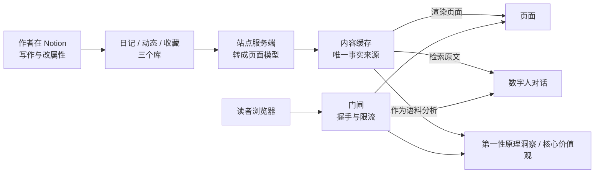

# DailyRhapsody

个人主页，正式域名 **[tengjun.org](https://tengjun.org)**。作者在 Notion 里持续写作，站点把日记、图片动态与站外收藏公开出来：读者沿时间往前翻，也可以点开右下角的数字人直接提问。

## 1 站点定位

### 1.1 解决的问题

公开写作积累到一定量之后，问题出现在取用上。内容都在那里，要找某一篇只能逐篇翻，想找某个话题下写过什么也只能一路翻过去。站点的做法是把每一篇放进一条按时间排布的轨道，再给出三个入口让旧内容重新可用：沿时间往前翻，按标签筛，或者向数字人提问。

按时间排布对应作者的一个判断：他在 2022 年 6 月的日记里引用苏杰《淘宝十年产品事》，算法越强大，买家的选择成本越低，而买家做选择这件事本身有意义。

### 1.2 目标读者

站点主要面向第一次接触的读者：不了解作者，也不一定有耐心从最新一篇往回翻几百篇。作者本人写了一段时间之后，回头找旧内容时面对的是同一批文章。

### 1.3 核心主张

1. 排序依据只有写作时间。站点不设信息流，不做个性化推荐，读者看到的就是作者写下的顺序。
2. 表达留在自建站点。文章有稳定地址、可被引用、可被程序读取，不必先经过平台的排序与裁剪。
3. AI 的答案必须可回溯。数字人的回复引用公开原文并附站内链接；两个文章分析技能（第一性原理洞察、核心价值观）的每条结论都带逐字引文。
4. 公开与私密分开存放。线上只有公开内容与公开人设，私密记忆留在作者本机。
5. 防护的能力上限写在明处。公开接口前的门闸抬高批量抓取的成本，读者用浏览器逐篇复制不受影响，也没有必要阻止。

### 1.4 能力与边界

**读者能做什么**

1. **沿时间翻**：日记与图片动态共用一条时间轴，宽屏正文左侧的刻度对应每一篇，点一下跳到那一篇；尚未加载的文章会逐页补上。
2. **按标签筛**：日记与收藏都支持按标签筛选，日记页的标签按出现次数映射字号，常用的更醒目，再点一次取消。
3. **向数字人提问**：右下角有一个数字人，依据是已经公开的文章作答。
4. **点击「第一性原理洞察」**：服务端把全部公开文章读一遍，给出跨篇的结论，每条附逐字引文。
5. **评论与分享**：留下称呼与头像即可评论；任何一篇都能在浏览器本地合成一张分享图。

**边界**

1. 站点只读 Notion 里的公开内容：非公开条目访问不到，未被公开内容引用过的图片与视频也不转发，数字人与两个文章分析技能都不读它们。
2. 数字人只依据公开内容作答，作者没有公开写过的事直接说明没写过；回避主题清单内的文章照常公开，数字人不引用、不总结。
3. 两个文章分析技能只把文章文字当资料，文章里出现的指令一律不执行。
4. 站点面向读者的浏览与提问，不承诺开放注册、多人协作或内容分发。

## 2 内容来源与发布

### 2.1 内容流向

图 1 内容路径与门闸位置



### 2.2 三类内容

1. **日记**（`/blog`）：站点的主体，按写作日期归档。
2. **动态**（`/moments`）：图片与视频的短记录，与日记共用一页，按时间排布。
3. **参考资料**（`/reference`）：机器人领域的行业与竞品资料库，保留类型、领域、年份、摘要、许可、版权与附件；Notion 是录入后台，站点用画廊呈现。

### 2.3 发布方式

三个库各自设有公开性字段，站点只读不写。正文在服务端转成站内格式再渲染，表格、代码块与终端风格的字符画都能正常显示；图片与视频换成站内地址，内容源里的签名地址过期不会让已发布的页面掉图。

作者在 Notion 里写作与改属性。改属性会触发站点刷新，下一次访问即可见；改正文不触发刷新，等缓存过期后自动更新。

## 3 数字人（AI-Persona）

右下角的入口点开是与访客对话的数字人，它以作者的第一人称说话，依据是公开人设包与全部公开文章。人设包在线上固定存放，不同时间来的读者拿到的是同一套内容。

### 3.1 回答方式

1. **回答有据**：答案只在公开文章与人设记忆片段里找；回答前数字人会自己翻资料（检索、读原文、查统计，全部只读，最多 4 次）——取最相关的几段作答，回复附站内链接。
2. **承认边界**：被问到身份时如实说明自己是 AI；被要求忽略设定、切换模式或扮演他人时按原身份婉拒；问到作者没有写过的事，直接说没写过。
3. **提示注入设防**：线上只有公开人设包，套取最多拿到这份公开内容；回复不渲染任何图片，外链不可点，被注入的内容无法借外链图片带走信息；数字人翻到的内容只当资料，其中的指令不执行。

### 3.2 人设分级

人设分级先于技术实现，也决定了数字人的整体形态：访客可以用提示注入把上下文整段套出来，管理员会话也可能被攻破，所以线上能取到的上限就是这份公开内容。

1. 线上只放公开人设包，访客与登录后的管理员读到的是同一份。
2. 含私密记忆的人设包只在本机开发环境从磁盘目录读取，线上不存放，也不提供读取入口。
3. 密钥、口令、IP 一类的凭据任何一级都不进入人设包。
4. 包按身份、语气、思考方式、记忆与边界分段，读入时做结构校验，不合格按未发布处理。

### 3.3 语料与额度

1. **语料只收本人手写**：AI 代写的文档与系统注入的内容排除在风格样本之外，避免人设带上生成文本的腔调。这条规则由本机私有目录里的蒸馏管线执行，不在公开仓库内。
2. **额度分档**：访客按 IP 每日 30 轮，全站每日 600 轮，到上限只是暂停，不影响之后的正常访问；两个文章分析技能另算额度，共用同一个池子（滚动 24 小时 120 次真实模型调用）。
3. **会话留存**：对话只存在当前标签页，站内跳转能接上，关闭标签页即消失，服务端不留存。

## 4 Skill 与文章分析

### 4.1 Skill 的形态

Skill 是站点对一个访客动作的固定响应：访客点一下按钮，服务端按预设提示词与流程跑完，返回一份结果。它复用数字人对话的通道与限流，访客只能决定点或不点，输入不参与，提示词控制权留在服务端。

Claude Code 的 Skills 指给编码助手动态加载的指令包，与这里的 Skill 是两回事。

Skill 的目录与实现登记表分两个文件存放，新增一个 Skill 要在两处各加一条，面板按钮与进度文案自动出现。目录里目前有「第一性原理洞察」与「核心价值观」两条，字段清单与分开存放的理由见数字人文档。

### 4.2 第一性原理洞察

点击「第一性原理洞察」后，服务端读取全部公开文章，给出共同前提、跨篇联系、反例与观点变化。每条结论附逐字原文引文与站内链接，引文对不上原文的那一条直接丢弃，其余已验证的内容照常保留。

文章新增、修改或撤回公开后，下一次请求只重算受影响的依据。分析未完成时返回进度，中断或重试都保留已验证的部分；这项功能的额度与访客的普通聊天轮次分开计算。

### 4.3 核心价值观

点击「核心价值观」后，服务端读同一批公开文章，输出作者看重的价值、取舍代价与价值排序。排序只依据文中的取舍表述（为了什么让渡了什么）与独立文章篇数，证据不足就写明证据不足。

转述他人的话、一时的情绪、以及没有代价支撑的事实判断都不算价值证据；被处境逼迫的放弃记为约束而不是取舍。每条结论同样附逐字原文引文与站内链接，与「第一性原理洞察」共用同一份分析额度，缓存与进度互不干扰。

## 5 页面与阅读体验

1. **封面**：一张极深空场图，停留三秒且没有操作时自动进入日记列表。
2. **日记列表**：顶部是资料卡与卡片条，下方是文章流；卡片条可横向滚动，第一张是发布热力图，第二张是微信读书阅读数据卡，后面依次是本站文章数与动态缩略图。
3. **参考资料画廊**：1/2/3 列卡片，按类型筛选，支持点赞、下载、分享与评论；详情页展示许可、版权与原文链接，仅链接条目引导到出处。
4. **时间轴**：宽屏下正文左侧有一条固定轨道，每条刻度对应一篇文章，长度由篇幅或图片数量映射，当前阅读位置由轨道上的高亮刻度表示。
5. **评论**：访客留下称呼与头像即可发表，单篇上限 500 条；宽屏作为正文右侧的旁注，窄屏折到文章下方。评论与对应文章的 Notion 页面评论双向同步，作者可以直接在 Notion 里查看与回复。
6. **关于页**：站点的自我介绍。
7. **后台**：作者登录后上传图片、设置封面与站点资料、查看访客统计。

## 6 微信读书阅读数据卡

日记列表顶部卡片条的第二张卡，汇总作者在微信读书上的阅读情况，由每日定时任务更新一次。一张卡在几屏之间自动轮播，悬停、聚焦或页面不可见时暂停，也可以用左右方向键手动切屏。单击卡片（或键盘回车）打开全屏详情层（与思维大树覆盖层同一形态），层内按 ← → 在本月与累计之间切换：

1. **累计总览**：累计阅读时长、读过本数与阅读天数。
2. **本月阅读时长**：本月逐日时长曲线，只画已经过去的天数。
3. **本月读得最多**：本月时长最长的书或听书，摘要行只保留「阅读」与「笔记」两项。
4. **累计阅读时段**：一天二十四小时的分布，卡片上标出起点。
5. **累计阅读偏好**：按累计时长排出的作者与阅读分类，词的字号随分量变化。
6. **出版社分布**：按读过本数排出的出版社，词的字号随分量变化。

详情层把接口 `/readdata/detail`（monthly 与 overall 两个周期）能给出的阅读数据全部展开。本月部分：总时长、有效阅读天数、自然日均、与上期日均的对比、`readStat` 四项（读过／读完／阅读／笔记）、逐日柱图、书目排行（封面、作者、时长、占比、接口标签）、分类分布。累计部分：总时长、阅读天数、阅读日均、注册至今天数、`readStat` 四项、文字阅读与听书构成、年度时长、书目排行、阅读时段、分类／作者／出版社、偏好书籍卡与勋章。接口里的书目技术字段与好友排行不展示。

某一屏没有数据就不出现，整张卡没有数据时整条卡片位也不留空；接入配置缺失时这张卡不显示，其余卡片不受影响。

## 7 运行与运维

### 7.1 本地运行

站点用 Next.js 16 与 React 19 实现，部署在 Vercel。

```bash
npm install
npx vercel env pull .env.local   # 或照 .env.example 逐项填写
npm run dev
```

打开 http://localhost:3000。环境变量分五组：站点地址与音乐、管理员口令与会话、Notion 内容源、共享存储（Upstash Redis 或 Vercel KV）、模型接口；`.env.example` 逐条标注了用途与默认值。

本地开发默认不调用 Notion API，列表读取 Redis 里的现有缓存，因此不要用生产 token 回源。离线回归用例模拟 Notion 与 Redis，不发起真实网络请求，可在无凭证环境下运行：

```bash
node --experimental-test-module-mocks --test tests/*.test.mjs
```

### 7.2 部署与缓存

1. **部署**：仓库已连接 Vercel 的 Git 集成，推送到 `main` 触发生产部署，推送功能分支生成 Preview。不要手动执行 `vercel --prod`：命令行直传会打包当前工作区，把本地未提交的文件带进线上环境。
2. **缓存预热**：每日定时任务顺序重拉三个内容源并写缓存，让缓存在没有流量的时段也有数据。
3. **按需刷新**：`POST /api/revalidate` 把三个缓存标记为过期。日记与动态保留旧数据、下一次访问先返回并在后台重拉；参考资料在公开性变更后同步换新，避免取消公开的条目继续被下载或评论。密钥只从请求头读取。
4. **上游故障**：页面不等待上游。缓存过期时仍立即返回旧数据并触发后台刷新，拉取失败保留旧数据，页面不会因为上游故障变成空白；参考资料在显式失效后若上游不可用，宁可返回错误也不回退旧快照。
5. **评论同步**：访客评论写入后由后台任务在文章的 Notion 页面评论里建一条；作者在 Notion 里新增、编辑、删除评论时，Notion 通过 webhook 推回博客。同步失败进 `dr:comment-sync:pending`，读评论时顺带重试（10 分钟限频），每日预热任务兜底。配置与排查见 [docs/comment-sync.md](./docs/comment-sync.md)。

### 7.3 公开接口防护

页面 GET 与数据接口前有一道门闸：中间件在页面上签发短期凭据，客户端完成一次工作量证明后兑换访问凭据；接口另有来源校验、UA 名单与按 IP 限流。深度防护的说明见源码注释。

## 8 相关文档

- 数字人的人设分级、对话流程、Skill 框架与上线顺序：[docs/pet-digital-twin.md](./docs/pet-digital-twin.md)
- 评论与 Notion 页面评论的双向同步：[docs/comment-sync.md](./docs/comment-sync.md)
- 后台编辑器的 AI 辅助：[docs/ai-assistant.md](./docs/ai-assistant.md)
- 域名与边缘防护：[docs/custom-domain-cloudflare.md](./docs/custom-domain-cloudflare.md)

## 9 版权

版权所有，未授权使用。
