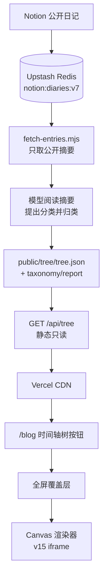

# DailyRhapsody 思维大树接入方案

## 1 结论

1. 展示层接入 v15：左侧时间轴底部增加树形按钮，点击打开全屏覆盖层，关闭后回到原滚动位置。v15 使用三维坐标、透视投影与深度排序，属于 3D 渲染。
2. 数据层只做只读服务：`GET /api/tree` 返回预生成的树 JSON，Vercel 不承担聚类与布局计算；当前产物是 `public/tree/tree.json`，由静态文件直接提供并带 CDN 缓存。
3. 语义分析离线运行：`scripts/tree/fetch-entries.mjs` 读取公开日记缓存，`scripts/tree/analyze.mjs` 让模型阅读摘要，自行提出家族、中类与细类并逐条归类。分类不使用站点的 `tags` 字段，也不把私密文章送进模型。
4. 几何生长算法留在前端：Canvas 按 JSON 渲染；条目规模较小时在浏览器计算布局，规模增大后再把布局结果前移到离线管线。
5. 当前已接入 269 篇公开日记：模型分析 257 篇有正文的日记，另外 12 篇短记没有可分析文本，单列为「短记」；所有叶子都带真实文章 ID，可回到博客定位。

## 2 现状与约束

1. 站点为 Next.js 16、React 19、TypeScript，部署在 Vercel；博客与动态共用 `/blog`。
2. 文章来自 Notion，经现有同步写入 `notion:diaries:v7`；每日 20:00 UTC 由 Vercel Cron 预热缓存。
3. 条目字段包含 `id`、`date`、`publishedAt`、`summary`、`tags`、`isPublic`；站点没有独立标题字段。
4. Upstash Redis 已在用，具备读写凭证；仓库有 GitHub Actions CI，当前只跑单测、类型与 lint。
5. 安全边界：树只处理公开文章；不引入 persona 模块；私密文章不进入管线，也不进入模型调用。
6. 发布边界：功能分支生成 Preview，合并 `main` 触发生产；不使用 `vercel --prod` 直传工作区。

## 3 总体架构

图 1 思维大树总体架构



三条边界：

1. 数据生产在离线环境完成，失败不影响博客。
2. 数据服务只读缓存或静态 JSON，单次请求开销稳定。
3. 展示层可回退到上一版 `tree.json`，接口异常不阻塞入口。

## 4 技术选型

| 层 | 选型 | 理由 |
|---|---|---|
| 页面框架 | 现有 Next.js 16、React 19 | 复用现有布局、主题与发布流程 |
| 树渲染 | Canvas 2D，手写 3D 透视投影、深度排序、轨道旋转 | 不引入 three.js；线宽、光晕与金色线稿可控 |
| 阶段 1 容器 | 同源 iframe 加载 `public/tree/v15.html` | v15 直接上线，关闭即卸载 |
| 阶段 2 组件 | `components/tree/CognitiveTree3D.tsx` | 去掉 iframe，接入真实 JSON、相机与主题 |
| 接口 | Next.js Route Handler（Node runtime） | 只读、可缓存，不承担重计算 |
| 数据缓存 | Upstash Redis（只作为公开条目来源） | 复用现有基础设施，不新增存储 |
| 树数据 | `public/tree/tree.json` 静态产物 | 269 条规模直接走 CDN，接口无计算 |
| 离线管线 | Node 24、ESM（`scripts/tree/*.mjs`） | 与站点同一运行时；不引入 Python 或第二套包管理 |
| 文本特征 | 模型阅读公开摘要 | 不依赖标签，能处理标签稀疏与同标签不同主题 |
| 分类与命名 | 现有模型供应商，低温度，只传公开摘要 | 家族/中类/细类一次生成；分类体系冻结在 `taxonomy.json` |
| 调度 | 当前手动 `npm run tree:rebuild`；后续接 GitHub Actions | 模型调用不进请求路径，失败不影响线上旧产物 |
| 校验 | TypeScript 类型 + 运行时守卫 + `node --test` | 与仓库现有测试体系一致 |
| 监控 | 管线报告 JSON、Actions 日志、接口缓存命中 | 不新增监控平台 |

## 5 后端放置

### 5.1 接口

1. `GET /api/tree`：返回 `public/tree/tree.json`；响应头使用 `Cache-Control: public, s-maxage=3600, stale-while-revalidate=86400`。
2. `GET /api/tree/report`：返回 `public/tree/report.json`，只含条目数、分析数、家族/中类数与生成时间。
3. 两个接口均为只读，不需要登录；不接收写操作。

### 5.2 存储结构

```text
public/tree/tree.json       -> 当前树数据（提交进仓库，随部署发布）
public/tree/taxonomy.json   -> 冻结的模型分类体系
public/tree/report.json     -> 最近一次生成报告
data/tree-entries.json      -> 公开摘要输入（本地生成，不提交）
```

当前以 Git 版本作为回滚手段：回退 `tree.json` 即回退上一棵树。Redis 版本指针与在线切换保留到需要每日自动更新时再加。

### 5.3 不放后端的东西

1. 聚类、embedding、LLM 命名：放入 Route Handler 会触发超时、内存与密钥暴露问题。
2. 大模型调用：不放在请求路径；管线离线完成并缓存结果。
3. 条目正文：接口只返回 ID、日期、细类与计数，不返回摘要全文。
4. 出站摘要：模型调用前经 `scripts/tree/redact.mjs` 遮掉手机号、邮箱、身份证、银行卡与上下文中的地址；宁可误伤，不把 PII 送到云端。

## 6 算法与数据管线

### 6.1 放置

```text
scripts/tree/
  fetch-entries.mjs    从 Redis 取公开 id/date/summary
  redact.mjs           出站摘要的 PII 遮罩
  analyze.mjs          模型提出分类、逐条归类、生成 tree.json
tests/tree-data.test.mjs  校验计数、唯一 ID、无正文/标签/私密字段
```

管线放在仓库根目录的 `scripts/tree/`，与 Next.js 运行时代码分开。命令：

```bash
npm run tree:fetch    # 拉取当前公开摘要
npm run tree:build    # 模型分析并写 public/tree/tree.json
npm run tree:rebuild  # 两步连跑
```

图 2 数据管线


### 6.2 三阶段算法

| 阶段 | 方法 | 产出 | 适用 |
|---|---|---|---|
| v1（当前） | 模型阅读摘要，提出分类体系并逐条归类；不使用 tags | 10 个家族、28 个中类、细类与真实条目 | 已上线 |
| v2 | embedding + umap-js + hdbscan-ts，模型命名 | 语义聚类、稳定 ID、自动命名 | 条目继续增长后 |
| v3 | 时间步 L-system + 异速约束 | 顶芽/侧芽驱动的生长树 | 形态与生长模型 |

### 6.3 稳定 ID

1. 每次运行保存聚类中心与上一版本的映射。
2. 新聚类与旧聚类做匈牙利匹配；相似度超过阈值才继承旧 ID 与旧名称。
3. 只允许新增、合并、拆分三种受控变更，并写入报告。
4. 验收指标使用 ARI（调整兰德指数），低于 0.7 不自动发布。

### 6.4 命名

1. 只用公开摘要生成名称，不传私密内容，也不使用 `tags`。
2. 名称长度 2–6 个汉字；同一层级不重名。
3. 第一次生成后把分类体系冻结在 `public/tree/taxonomy.json`；后续运行优先复用，只有新增家族/中类时才扩展。

### 6.5 调度

1. 当前手动运行 `npm run tree:rebuild`，产物随 PR 发布；模型调用不进入 Vercel 请求路径。
2. 后续接 GitHub Actions，每日 20:30 UTC 排在缓存预热之后；支持手动触发。
3. 管线读取缓存的 `refreshedAt`；缓存过旧时重试一次，仍失败则保留上一版本并在报告标记。
4. 发布失败不改变线上 `tree.json`。

## 7 数据契约

```json
{
  "schema": "dr.tree/1",
  "generatedAt": "2026-10-17T22:28:13.800Z",
  "epochMonth": 24243,
  "lastDate": "2026-10-13",
  "source": { "entries": 269, "public": 269 },
  "families": [
    {
      "id": "工作与产品",
      "name": "工作与产品",
      "topics": [
        {
          "id": "工作与产品-产品逻辑",
          "name": "产品逻辑",
          "subs": [{ "name": "产品判断", "count": 8 }],
          "entries": [
            { "id": "notion-page-id", "date": "2026-08-26", "t": 63.8, "sub": "产品判断" }
          ]
        }
      ]
    }
  ]
}
```

约束：

1. `entries` 只含公开文章的 ID、日期、相对月份与所属细类；不含正文、标题、图片与作者信息。
2. 计数由 `entries` 派生，避免计数与明细不一致。
3. 文件目标小于 300 KB；269 条当前约 34 KB。
4. v15 的 `notesFromTree()` 直接读取这个契约，不再维护另一套 `FAMILIES` 结构。
5. `source.entries` 是公开条目总数；`source.public` 与叶子数一致。短记没有正文时进入「短记」，不伪造语义归类。

## 8 前端接入

### 8.1 阶段 1

1. 复制 `cognitive-tree-v15-grow.html` 到 `public/tree/v15.html`，保持自包含。
2. `ScrollTimeline` 增加可选 `onOpenTree`，在轨道下方渲染 36px 树形按钮；只传博客时间轴，动态页不显示。
   v15 页面只保留树、博客滑杆与「生长回放」按钮；标题、日期、统计面板、操作提示与页脚说明全部移除。
3. 新增 `CognitiveTreeOverlay`：`role="dialog"`、`aria-modal`、Esc 关闭、焦点还原、body 滚动锁、同源 iframe。
4. `EntriesPageClient` 增加 `treeOpen` 状态；树打开时禁用 tab 横滑；叶子点击消息由 `postMessage` 回传，关闭覆盖层后定位文章。
5. 覆盖层 `z-[400]`，高于图片预览的 `z-[300]`；点击叶子后若文章未加载，复用 `requestEntry` 逐页补载。

### 8.2 阶段 2

1. 用 `next/dynamic` 按需加载 `CognitiveTree3D` 组件，替换 iframe。
2. 组件从 `/api/tree` 取 JSON，复用 v15 的相机、深度排序与 Canvas 绘制。
3. 主题跟随博客明暗；树本身保持金色线稿，背景使用站点底色；3D 相机默认缓慢自转，拖拽后暂停。

### 8.3 入口规则

1. 按钮跟随时间轴可见性，仅在宽屏精确指针环境出现。
2. 移动端暂不加入口；后续可放在顶部卡片条或菜单。
3. 打开覆盖层不改变 URL，不打断阅读位置；关闭后焦点回到按钮。

## 9 上线、回滚与验收

### 9.1 上线

1. 从 `origin/main` 新开分支，当前基线为 `1cac3ee`；未提交的 `docs/agent-upgrade-plan.md` 不带入。
2. 阶段 1 单独一个 PR：v15 静态文件、按钮、覆盖层。
3. 阶段 2 单独一个 PR：接口、静态 fixture、适配层。
4. 阶段 3 单独一个 PR：管线、调度、发布脚本。
5. 合并前跑 `npm run lint`、`npx tsc --noEmit`、`npm run build`、`npm run test`；Preview 点通后合并。

### 9.2 回滚

1. 入口异常：关闭 `NEXT_PUBLIC_TREE_ENTRY` 或移除按钮，博客其他功能不受影响。
2. 数据异常：把 `public/tree/tree.json` 回退到上一提交。
3. 接口异常：前端显示「树数据加载失败」，不展示假数据。
4. 管线异常：不发布新版本，保留旧指针。

### 9.3 验收

| 维度 | 指标 |
|---|---|
| 数据覆盖 | 公开条目覆盖率 ≥ 95%；无正文条目单列，不丢 ID |
| 结构 | 8–12 个家族、12–30 个中类，细类计数与条目一致 |
| 稳定性 | 相邻两次运行 ARI ≥ 0.7 |
| 接口 | 缓存命中 p95 < 100 ms，返回体 < 300 KB |
| 页面 | 打开覆盖层 < 300 ms，关闭后滚动位置不变，无布局跳动 |
| 可访问性 | Esc 关闭、焦点还原、iframe 有标题、按钮有 aria-label |
| 隐私 | 产物不含私密条目 ID、正文、persona 数据 |

## 10 分阶段计划

| 阶段 | 内容 | 交付 | 预估 |
|---|---|---|---|
| P1 | v15 静态文件、时间轴按钮、覆盖层 | 可点开的树入口 | 已完成 |
| P2 | `/api/tree`、静态 fixture、v15 适配层 | 数据可替换 | 已完成 |
| P3 | 公开摘要管线、模型分类、报告、静态产物 | 真实计数与条目 | 已完成 |
| P4 | embedding、聚类、稳定 ID、自动命名 | 语义树增强 | 待做 |
| P5 | 时间步生长模型、异速约束 | 真实生长树 | 1–2 周 |

P1 与 P2 可以并行设计，P3 依赖 P2 的契约，P4 依赖 P3 的报告与冻结表。

## 11 风险与边界

1. 分类漂移：分类体系冻结在 `taxonomy.json`；条目新增时优先复用旧路径，只有无法归类时才扩展中类。
2. 聚类漂移：稳定 ID 与 ARI 门槛控制；不达标不自动发布。
3. 命名质量：冻结表与人工复核；模型只生成候选。
4. 私密泄漏：管线入口过滤 `isPublic`，产物只留 ID 与日期，测试守卫检查禁用字段；出站摘要先做 PII 遮罩。
5. iframe 可访问性：焦点管理、Esc、标题与关闭按钮齐备；阶段 2 去掉 iframe。
6. Vercel 限制：聚类不进入请求路径；接口只读缓存。
7. 成本：269 条 embedding 调用量小；命名调用单独计量，不占 persona 分析额度。
8. 模型与算法边界：v15 只解决展示入口；真正的生长模型在 P5，当前不把 v16 实验版上线。


## 12 开发语言收敛

### 12.1 现状

1. 仓库主力是 TypeScript 与 JavaScript：115 个 `.ts`、49 个 `.tsx`、24 个 `.mjs`，没有 Python 运行时。
2. 树方案若引入 Python 管线，会增加第二套运行时、依赖、CI、数据契约与部署环境。
3. 269 条公开条目用 TypeScript 足够处理；语义聚类可以走 API embedding 加 `umap-js`、`hdbscan-ts`。

### 12.2 目标

1. 一套语言：TypeScript。
2. 一个 Node 版本：24。
3. 一个 lockfile：现有 `package-lock.json`。
4. 一条 CI：`npm ci` → `npm run test` → `npx tsc --noEmit` → `npm run lint`。
5. 一份契约：`public/tree/tree.json` 的 `dr.tree/1` 结构同时被管线、API 与前端引用。

### 12.3 放置

| 环节 | 技术 |
|---|---|
| 数据管线 | `scripts/tree/*.mjs`，Node 24 直接执行 |
| 数据接口 | `app/api/tree/route.ts` 与 `app/api/tree/report/route.ts` |
| 树渲染 | `public/tree/v15.html` + Canvas |
| 调度 | 当前手动；后续 `.github/workflows/tree.yml`，Node 24 |
| 存储 | 静态 JSON（来源仍是 Upstash Redis 的公开缓存） |
| 测试 | `node --test`，沿用现有测试体系 |

### 12.4 算法依赖

1. v1 用模型阅读摘要完成分类，不引入 embedding 与机器学习依赖，也不使用标签。
2. v2 用 API embedding 加 `umap-js`、`hdbscan-ts`；聚类质量不达标时，用 TypeScript 实现余弦距离的层次聚类作为替代。
3. Python 只在独立研究目录或本地实验中保留，产物为 JSON 文件，不进入生产运行时。
4. `hdbscan-ts` 属于较小的实现，接入前用固定样本做轮廓系数与稳定性测试；指标不达标就不替换 v1。

### 12.5 治理

1. 新功能默认用 TypeScript；引入第二语言需要说明收益、维护成本与退出条件。
2. 不新增第二套包管理器、SQL 数据库、GraphQL 层或 three.js。
3. 管线与前端共享类型，禁止各自维护一套 JSON 结构。
4. 数据管线的构建命令固定为 `npm run tree:build`，避免出现第二套运行说明。
