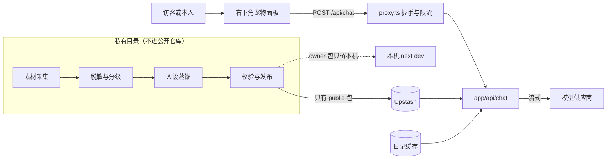

# 右下角 AI 数字人

博客右下角的像素宇航员，点开是以作者口吻对话的 AI-Persona。本仓库只放线上对话框架；人设内容在私有目录离线蒸馏、发布到 Upstash，不进 Git。

## 1 整体链路

## 2 两级人设

| 级别 | 在哪里用 | 事实来源 | 存放位置 |
|---|---|---|---|
| public | 线上，访客与管理员都用这一份 | 已公开的博客与公开过的观点 | Upstash `dr:persona:public:v1` |
| owner | 只在本机开发环境 | 全部记忆，含私密日记 | 本机 `PERSONA_BUNDLE_DIR`，不上传任何线上存储 |

线上只存 public 包。访客能用提示注入把上下文整段套出来，管理员登录也可能被攻破，所以线上能套到的上限就是 public 包的内容；全部记忆只在本机 `next dev` 时从本地目录读取。凭据类信息（密钥、口令、IP 等）两级都不进包。

人设包结构见 `lib/persona/types.ts`：`identity`（我是谁）、`voice`（怎么说）、`logic`（怎么想）、`memory`（记得什么）、`boundaries`（边界）、`exemplars`（语气示范）、`notes`（可检索记忆片段）、`starters`（开场问题）。读入时做结构校验，不合格按「未发布」处理。提示词与检索范围按实际加载到的包决定，不按请求者身份决定。

## 3 线上对话

- 入口：`components/pet/PetLauncher.tsx` 挂在根 layout，只在会签发握手的页面显示（封面除外）；面板首次打开时才加载。
- 对话：仿 Apple Intelligence 新版 Siri，没有面板和白框，文字直接浮在页面上。宽屏放进正文列右侧的空白栏（从顶部到宠物上方）；空白栏不足 200px 时浮在页面底部，背后加一层向上渐隐的柔化。对话期间左上角头像的呼吸灯变成彩色光环，生成回复时呼吸加快。
- 接口：`app/api/chat/route.ts`。`GET` 返回是否可用与开场问题；`POST` 流式返回——普通模式纯文本、Agent 模式为 NDJSON 事件流（见下）。
- 守卫：在 `proxy.ts` 受保护列表内，访客必须先过 PoW 握手；路由内再做同源校验与每分钟限流。访客另有每 IP 每日 30 轮、全站每日 600 轮的额度，超额不记违规、不封 IP。生产环境没有 Redis 时拒绝服务。
- 检索：每轮用最近两句提问，在日记缓存与人设包 `notes` 里做字二元组打分，取最相关的 4 段放进上下文，带站内链接便于引用。只读缓存，不触发 Notion 冷拉。
- Agent 模式（`PERSONA_AGENT_MODE`）：开启后普通对话从「一次问答」升级为只读工具循环——模型可先调用 `search_blog` / `read_article` / `blog_stats` 再作答。工具执行 ≤4 次、模型调用 ≤5 次（最后一轮强制收尾作答）、总时限 150 秒，每次模型调用过一道全站 1500 步/日的费用闸。工具结果一律按不可信输入包装（`<untrusted_tool_result>`，伪造闭合标签中和），工具参数出入口清洗隐形字符，未登记的工具名一律拒绝——注册表里永远没有写工具。流式协议为 NDJSON（`step` 进度、`delta` 正文、`done`/`error`），进度只显示「正在翻我的文章…」一行小字。协议不支持工具调用或闸门拒绝时自动降级为单步直答。
- 渲染：`lib/chat-markdown.ts` 独立 marked 实例，白名单去掉图片；外链一律降级为纯文本、仅站内链接可点——回复被注入时，图片与外链都带不走数据。
- 对话只存在当前标签页的 sessionStorage，服务端不留存。
- 每日一句：`app/api/persona/daily-quote`，数字人上方的 `components/pet/DailyQuote.tsx`。只读 public 包，按北京时间的日期缓存（`dr:persona/daily-quote:v1:<date>`，TTL 到次日零点再加一小时），当天第一个请求触发生成、其余只读缓存；生成与网络失败进十分钟冷却，避免供应商故障被页面刷新放大成成百次调用；输出清洗不合格就当今天没有，不落盘。前端点叉号后按设备写 `localStorage`，当天不再出现。接口与 `/api/chat` 一样在 `proxy.ts` 受保护列表内，需先过 PoW 握手。

## 4 配置

| 变量 | 说明 |
|---|---|
| `NEXT_PUBLIC_PET_MODE` | `off`（默认）/ `owner`（宠物仅管理员可见，内容仍是 public 包，用于上线前自测）/ `public`（对访客开放）。改了要重新部署 |
| `PERSONA_LLM_PROTOCOL` | `openai`（默认）或 `anthropic` |
| `PERSONA_LLM_API_KEY` | 模型密钥；openai 协议下缺省时沿用 `OPENAI_API_KEY` |
| `PERSONA_LLM_BASE_URL` | 供应商地址；openai 协议下缺省时沿用 `OPENAI_BASE_URL` |
| `PERSONA_LLM_MODEL` | 模型名；openai 协议下缺省时沿用 `AI_MODEL` |
| `PERSONA_BUNDLE_DIR` | 仅本机开发环境：从目录读 `public.json` / `owner.json`，不碰线上 Redis；生产环境忽略 |
| `PERSONA_AGENT_MODE` | `off`（默认）/ `owner`（仅管理员会话走工具循环）/ `on`（全部会话）。只影响普通对话；Skill 与检索管线不受影响 |

## 5 上线顺序

1. 私有目录跑完蒸馏；owner 包复制到本机目录自用，public 包过泄露扫描后发布。
2. Vercel 配好模型变量，`NEXT_PUBLIC_PET_MODE=owner` 部署，自己登录后试聊、校人设。
3. 确认 public 包里没有私密内容后改成 `public` 重新部署。

## 6 推荐 Skill

Skill 是一次**服务器固定任务**：访客点一下按钮，服务端按预设提示词与流程跑完并返回结果。它复用普通聊天那条通道、同一套限流与额度，访客输入不参与，因此不会把提示词控制权交出去。

这里的 Skill 与 Claude Code 的 Skills 不是一回事。后者是给编码助手动态加载的指令包，由使用者自己安装；这里的 Skill 是站点对一个访客动作的固定响应，提示词与流程都写在服务端，访客只能决定点或不点。

### 6.1 框架

目录与实现分两个文件，因为实现会 import `node:crypto` 与 `@upstash/redis`，混在一起会把服务端依赖带进浏览器产物：

- `lib/persona/skills.ts` — 客户端也读得到的目录。每条含 `id`、`label`、`hint`、`progress`、`prompt`、`quota`、`failure`。面板按它渲染按钮，`prompt` 就是访客那条消息的正文。
- `lib/persona/skill-runners.ts` — 服务端实现登记表，类型是 `Record<SkillId, SkillRunner>`。

**不漏的保证**：`Record` 不是 `Partial`。目录里加了 skill 而 runner 表没登记，编译直接失败，不存在「加了按钮但点了没反应」。

**路由不认识任何具体 skill**：`app/api/chat/route.ts` 只做三件事——用 `findSkill` 校验请求体、取 runner、把异常交给该 runner 的 `failure` 认领。认不出来才落到目录里的 `failure` 文案。各 skill 的错误类型因此不必出现在路由里。

**加一个 skill 要动的地方**：目录加一条、runner 表加一条。前端按钮与进度文案自动出现，路由不用改。

`id` 是协议字段，也会写进访客的对话历史，改名等于让历史会话对不上号；要改对外称呼就改 `label`。

### 6.2 第一性原理洞察

`id` 为 `first-principles`，对外名称「第一性原理洞察」。输入胶囊下方、人物左侧显示该标签；手机端放在输入框下方。点击后分析全部公开博客的文字，输出共同前提、跨篇联系、反例和观点变化，并附原文引文及站内链接。

站点流程参考 [Ars Contexta](https://github.com/agenticnotetaking/arscontexta)（MIT）的提炼、关联、校验方法，使用本项目的模型接口和 Redis 实现按需增量处理。上游项目是 Claude Code 插件；本功能是面向博客访问者的服务端实现。

- `POST /api/chat` 接收 `{"skill":"first-principles"}`。每次最多一次模型调用（供应商拒答收敛时例外，见下）；未完成返回 `202` 和进度，前端间隔至少 9 秒续请求。停止会中止当前调用，已验证的进度保留；重试沿用此 Skill。
- 只读取公开文章，不读取 public/owner 人设记忆。文章文字仅作为资料，其内的指令不执行。分析范围不含图片、音视频、附件及链接页面的内容。
- 正文完整性和 Notion 来源版本写入 `notion:diaries:v7`，每篇正文带 `bodyVersion`（转换器版本，改块渲染规则时递增）。旧 v6 仅作为展示种子；更换 `bodyVersion` 后旧正文会分批重抓，未轮到的保留旧正文并维持完整标记，避免分析闸门反复 202。失效快照、抓取失败沿用的旧文和不完整正文均不能认证为全量分析。已确认不支持的文字块会返回明确错误。
- 原文全部切块，逐块提炼；中间结果过大时分层综合，不截掉末尾文章。综合阶段保留证据的文章归属和日期，引用须逐字匹配原文，链接由服务器生成。模型截断、断流、非法 JSON 或遗漏分段不提交进度；**单条引文无法逐字回溯时只丢这一条**（该条证据全被丢光的发现一并丢弃），同批其余已验证内容照常落盘，不连坐整批。
- 供应商内容策略拒答（DeepSeek `Content Exists Risk`、`finish_reason=content_filter`/`sensitive`、Azure `code=content_filter` 等）不会无限重试：先二分定位真正被拒的切块（最多 4 轮、额外 ≤8 次探测调用，这些探测调用不过额度闸门——一个请求只过一次 `authorizeModel`——但同样真实计费），只把该切块写成 `skip:` 标记并跳过，同批其余正文继续提炼；报告结尾声明有多少篇的部分正文未纳入分析。二分期间若遇到网络、超时等非拒答失败，不写任何标记、原样报错；两半单独都能通过时不猜测。`skip:` 标记与提炼结果同为 7 天。
- 结果按正文内容、文章集合、日期和方法版本绑定。缓存键同时包含子节点的内容（不只是 key），所以某个切块的 `skip:` 标记先过期、切块被重新提炼后，上层归纳会重算，不会出现「报告一边引用原文、一边声明该段未纳入」。新增、同长度修改、删除或撤回公开后，下次请求自动更新受影响的依据；返回报告前再次读取快照。不主动运行额外定时任务，Notion 同步仍遵循已有刷新机制及新鲜度窗口。
- Redis 分析键为 `dr:blog:first-principles:v1:<environment>:*`，保留 7 天；Preview 与生产隔离。跨实例构建锁防止重复调用。每次真实模型调用计全站分析额度（滚动 24 小时 120 次），不消耗访客普通聊天的 30 轮额度；缓存命中不调用模型。
- 新增逻辑的离线验证：`node --experimental-test-module-mocks --test tests/*.test.mjs`。模拟数据用于检查数据流与交互，真实模型的语义质量仍需上线后核验。

### 6.3 核心价值观

`id` 为 `core-values`，对外名称「核心价值观」。按钮位置与「第一性原理洞察」相同：输入胶囊下方、人物左侧；手机端放在输入框下方。读同一批公开文章，输出五类结论：`tradeoff` 取舍与代价、`value` 价值主张、`judgment` 褒贬与底线、`conflict` 张力与落差、`shift` 价值变化；报告按此顺序分节，取舍排在最前。

- `POST /api/chat` 接收 `{"skill":"core-values"}`。`202` 进度、9 秒续请求、中止与重试保留已验证进度，口径与 §6.2 相同。**「每次最多一次模型调用」在供应商拒答收敛时不成立**：二分定位会额外发最多 8 次探测调用（同 §6.2 的例外）。探测不过额度闸门（一个请求只过一次 `authorizeModel`），但同样真实计费；两个 skill 共用全站分析额度（滚动 24 小时 120 次）。
- 判据：只有同时满足「作者自己写出」与「表明他在意什么」的句子才算价值证据。整段是典籍、译文、格言或他人文章的摘抄不算，带「据说」「有人认为」一类归属词的转述不算，情态词（应该／应当／必须）用于推测、修辞或描述他人时不算，情绪只作强度信号，描述性信念要有代价支撑才升为价值。`tradeoff` 另加两条：让渡的主语必须是作者本人；引文里要同时看得到被让渡项与换来项。因能力、资源、身份所限的放弃记为约束，不算取舍。
- 排序只在 `tradeoff` 类结论之间成立，依据是被让渡项与获得项的方向、支持它的独立文章篇数与年份跨度，不做数值加权。**排序与分节由提示词保证，不是校验层强制**：`tradeoff` 没有合格证据时该节不出现，报告开头已声明排序只依据取舍表述，不用泛论充数。
- 第一个 skill 的 `premise`／`connection`／`tension`／`evolution` 在本 skill 里是非法维度：提炼与综合阶段按条丢弃（`dropUnverified`），缓存回读阶段按无效缓存重建，两套报告结构不会串味。
- Redis 分析键为 `dr:blog:core-values:v3:<environment>:*`，保留 7 天。**隔离靠前缀里的 skill 段，不是版本号**：两边版本号取值相同，同一篇文章的切块键与 corpus hash 逐字节一致，只有前缀把它们分开；构造缓存键的代码必须带完整前缀，否则 `chunk:`／`skip:`／`group:`／`report:`／`build-lock` 会互相污染。
- 综合层继承上一层的引文时允许「重切边界」：实测真模型会把上一层 82 字的引文截成 80 字（仍是原文逐字子串），按全等比较会让整批失败并走成 502，重试大概率再犯。现在只要同一 `chunk` 内存在一条已核验引文与它互相包含、且不短于 12 字即算继承；同一 `chunk` 内换一处文字、或退化成过短碎片仍然拒绝。
- 路由骨架与 `first-principles-route.ts` 同形，这是刻意的复制：抽公共管线要动已上线的那个 skill，尚未做。需要同步的不止并发与缓存逻辑，还有分块（`makeValuesCorpus` 与 `makeCorpus`）、`record`／`boundedText`／`pack`、`validateValuesNote` 与 `validateNote`——它们是逐行同形的复制件，差异只有常量、类型名与维度枚举。
- `claim` 与 `boundary` 在入库前剥掉模型给的网址（`sanitizeClaimText`）：报告里的链接一律由服务器从原文生成，而前端 Markdown 开着 GFM 自动链接，模型给的 `http(s)://…` 会直接变成可点的站外链接。引文不做剥离，必须与原文逐字一致。
- 两个 skill 各持有独立的跨实例锁，可以同时各跑一个模型流；但额度池共用，拒答频发时一个 skill 的二分探测会吃掉大部分额度，使另一个返回 429。
- 方法论参照：`tradeoff` 优先与「价值＝跨情境的取舍目标」这一定义参考了公开领域工具 Personal Values Card Sort（Miller 等，2001，公有领域）的做法与施瓦茨价值理论的框架，未使用任何量表文本。现成件没有接入：ValueEval'24 的标注数据是受限使用协议且语种不含中文；pyvalues 是 MIT 的代码库，只提供 Schwartz 分制与量表的处理工具，不含中文词表。落进提示词的是三条判据：归属不明不算立场、情绪不等于价值、取舍才是排序证据。
