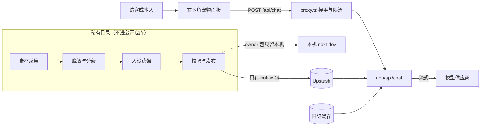

# 右下角 AI 数字人（AI-Persona）

博客右下角的像素宇航员，点开是以作者口吻对话的数字人。本仓库只放线上对话框架；人设内容在私有目录离线蒸馏、发布到 Upstash，不进 Git。

## 1 整体链路

## 2 两级人设

| 级别 | 在哪里用 | 事实来源 | 存放位置 |
|---|---|---|---|
| public | 线上，访客与管理员都用这一份 | 已公开的博客与公开过的观点 | Upstash `dr:persona:public:v1` |
| owner | 只在本机开发环境 | 全部记忆，含私密日记 | 本机 `PERSONA_BUNDLE_DIR`，不上传任何线上存储 |

线上只存 public 包。访客能用提示注入把上下文整段套出来，管理员登录也可能被攻破，所以线上能套到的上限就是 public 包的内容；全部记忆只在本机 `next dev` 时从本地目录读取。凭据类信息（密钥、口令、IP 等）两级都不进包。

人设包结构见 `lib/persona/types.ts`：`identity`（我是谁）、`voice`（怎么说）、`logic`（怎么想）、`memory`（记得什么）、`boundaries`（边界）、`exemplars`（语气示范）、`notes`（可检索记忆片段）、`starters`（开场问题）。读入时做结构校验，不合格按「未发布」处理。提示词与检索范围按实际加载到的包决定，不按请求者身份决定。

## 3 线上对话

- 入口：`components/pet/PetLauncher.tsx` 挂在根 layout，只在会签发握手的页面显示（封面除外）；面板首次打开时才加载。
- 对话：仿 Apple Intelligence 新版 Siri，没有面板和白框，文字直接浮在页面上。宽屏放进正文列右侧的空白栏（从顶部到宠物上方）；空白栏不足 200px 时浮在页面底部，背后加一层向上渐隐的柔化。对话期间左上角头像的呼吸灯变成彩色光环，生成回复时呼吸加快。
- 接口：`app/api/chat/route.ts`。`GET` 返回是否可用与开场问题，`POST` 流式返回纯文本。
- 守卫：在 `proxy.ts` 受保护列表内，访客必须先过 PoW 握手；路由内再做同源校验与每分钟限流。访客另有每 IP 每日 30 轮、全站每日 600 轮的额度，超额不记违规、不封 IP。生产环境没有 Redis 时拒绝服务。
- 检索：每轮用最近两句提问，在日记缓存与人设包 `notes` 里做字二元组打分，取最相关的 4 段放进上下文，带站内链接便于引用。只读缓存，不触发 Notion 冷拉。
- 渲染：`lib/chat-markdown.ts` 独立 marked 实例，白名单去掉图片，防止回复被注入后用外链图片带出数据。
- 对话只存在当前标签页的 sessionStorage，服务端不留存。

## 4 配置

| 变量 | 说明 |
|---|---|
| `NEXT_PUBLIC_PET_MODE` | `off`（默认）/ `owner`（宠物仅管理员可见，内容仍是 public 包，用于上线前自测）/ `public`（对访客开放）。改了要重新部署 |
| `PERSONA_LLM_PROTOCOL` | `openai`（默认）或 `anthropic` |
| `PERSONA_LLM_API_KEY` | 模型密钥；openai 协议下缺省时沿用 `OPENAI_API_KEY` |
| `PERSONA_LLM_BASE_URL` | 供应商地址；openai 协议下缺省时沿用 `OPENAI_BASE_URL` |
| `PERSONA_LLM_MODEL` | 模型名；openai 协议下缺省时沿用 `AI_MODEL` |
| `PERSONA_BUNDLE_DIR` | 仅本机开发环境：从目录读 `public.json` / `owner.json`，不碰线上 Redis；生产环境忽略 |

## 5 上线顺序

1. 私有目录跑完蒸馏；owner 包复制到本机目录自用，public 包过泄露扫描后发布。
2. Vercel 配好模型变量，`NEXT_PUBLIC_PET_MODE=owner` 部署，自己登录后试聊、校人设。
3. 确认 public 包里没有私密内容后改成 `public` 重新部署。

## 6 推荐 Skill：第一性原理

输入胶囊下方、人物左侧显示「第一性原理」标签。点击后分析全部公开博客的文字，输出共同前提、跨篇联系、反例和观点变化，并附原文引文及站内链接。手机端标签放在输入框下方。

站点流程参考 [Ars Contexta](https://github.com/agenticnotetaking/arscontexta)（MIT）的提炼、关联、校验方法，使用本项目的模型接口和 Redis 实现按需增量处理。上游项目是 Claude Code 插件；本功能是面向博客访问者的服务端实现。

- `POST /api/chat` 接收 `{"skill":"first-principles"}`。每次最多一次模型调用；未完成返回 `202` 和进度，前端间隔至少 9 秒续请求。停止会中止当前调用，已验证的进度保留；重试沿用此 Skill。
- 只读取公开文章，不读取 public/owner 人设记忆。文章文字仅作为资料，其内的指令不执行。分析范围不含图片、音视频、附件及链接页面的内容。
- 正文完整性和 Notion 来源版本写入 `notion:diaries:v6`。旧 v5 仅作为展示种子；失效快照、抓取失败沿用的旧文和不完整正文均不能认证为全量分析。已确认不支持的文字块会返回明确错误。
- 原文全部切块，逐块提炼；中间结果过大时分层综合，不截掉末尾文章。综合阶段保留证据的文章归属和日期，引用须逐字匹配原文，链接由服务器生成。模型截断、断流、非法 JSON、遗漏分段或伪造引文均不提交进度。
- 结果按正文内容、文章集合、日期和方法版本绑定。新增、同长度修改、删除或撤回公开后，下次请求自动更新受影响的依据；返回报告前再次读取快照。不主动运行额外定时任务，Notion 同步仍遵循已有刷新机制及新鲜度窗口。
- Redis 分析键为 `dr:blog:first-principles:v1:<environment>:*`，保留 7 天；Preview 与生产隔离。跨实例构建锁防止重复调用。每次真实模型调用计全站分析额度（滚动 24 小时 120 次），不消耗访客普通聊天的 30 轮额度；缓存命中不调用模型。
- 新增逻辑的离线验证：`node --experimental-test-module-mocks --test tests/*.test.mjs`。模拟数据用于检查数据流与交互，真实模型的语义质量仍需上线后核验。
